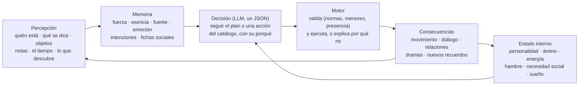
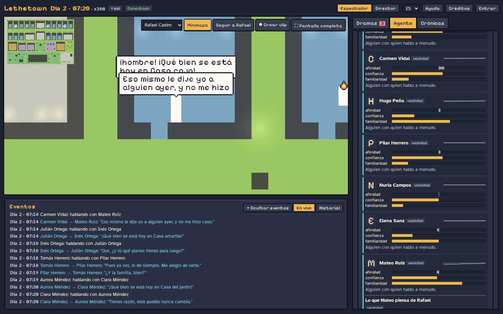

# Lethetown

**Un pueblo de 20 vecinos movidos por un LLM con una memoria que olvida, se reescribe al recordar
y confunde quién le contó qué, como la humana.** Es un juego que se ve en el navegador y un banco
de pruebas: cada olvido, cada recuerdo que cambia y cada meta queda medido y auditado.

**[Investigación](docs/investigacion/README.md) · [Colabora](CONTRIBUTING.md) ·
[Hoja de ruta](docs/roadmap.md) · [Decisiones](docs/decisiones/README.md) ·
[Documentación](docs/README.md)** · [English](docs/en/README.md)

Un pueblo en pixel art donde cada habitante es un **agente controlado por un LLM** (Anthropic u
OpenAI). Parte de [_Generative Agents_](https://arxiv.org/abs/2304.03442) (Park et al., 2023):
flujo de memoria, recuperación por recencia, importancia y relevancia, planificación y reflexión.
A eso le añade lo que hace humana a la memoria:

- **Olvido y vaguedad**: la fuerza de cada recuerdo decae con el tiempo de juego; por debajo de
  un umbral solo queda la esencia y por debajo de otro ya no se recupera.
- **Repetición espaciada y congruencia con el ánimo**: recordar refuerza (más cuanto más débil
  estaba) y se recuerda mejor lo que encaja con el ánimo.
- **Consolidación nocturna**: al dormir, el agente reflexiona sobre el día citando sus recuerdos,
  refuerza lo importante y debilita lo trivial.
- **Reconsolidación y confusión de fuente**: los recuerdos se reescriben un poco al evocarlos
  (con historial de versiones) y «me lo contó X» puede pasar a «lo viví».
- **Fichas sociales, rumores y olvido por presupuesto**, cada olvido registrado con su motivo.
- **Psicología**: Big Five y perfil de memoria propios, ánimo en dos dimensiones, hábitos, sueño,
  sesgos, falsos recuerdos, memoria prospectiva y relaciones que evolucionan.
- **Acciones con consecuencias** y **normas del mundo** (casas privadas, horarios): la IA decide,
  el motor comprueba si es posible y lo ejecuta.
- **Mallorca, 2002**: un pueblo inventado del interior, recién llegado el euro, con móviles
  sencillos y sin redes sociales; cada vecino sabe lo que sabría alguien con su vida en esa época.
- **Metas, habilidades y saberes** medidos por el motor: avanzar motiva, estancarse frustra; se
  aprende practicando y los saberes se deforman al contarse.
- **Protección de menores**: nada romántico con un menor, ni en los prompts ni en lo que escribe
  el LLM, y ningún adulto a solas con un menor fuera de un sitio público.

Todo funciona **sin API keys** con un proveedor simulado (mock). La pregunta que guía el
proyecto: **¿qué pasa cuando la memoria de los habitantes deja de ser un registro fiable e
ilimitado?** La hipótesis (abierta, no un resultado) es que el olvido, la reconstrucción de los
recuerdos y las diferencias psicológicas dan historias más variadas y verosímiles. Ver
[Investigación](docs/investigacion/README.md).

## Un habitante, por dentro

Cada vecino percibe, recuerda, siente, decide y actúa. Hay **dos capas**: reglas programadas
(reloj, rutas, umbrales de memoria, ánimo, necesidades, normas, validación de acciones) y el
modelo de lenguaje, solo donde el lenguaje y el contexto aportan (decidir, conversar, resumir,
reflexionar). Así se controla el coste, se audita cada decisión y las pruebas son reproducibles.



Cada uno tiene identidad y forma de hablar, personalidad que deriva muy despacio, emociones y
necesidades, memoria e intenciones, relaciones no necesariamente recíprocas, lo que conoce del
pueblo, sus pertenencias, 14 habilidades y los saberes del pueblo a su manera. El detalle, en
[Arquitectura](docs/arquitectura.md#un-habitante-por-dentro).

## Qué pueden hacer

**La IA decide, el motor valida y ejecuta.** En cada decisión el modelo elige seguir con el plan o
una acción del catálogo con su porqué: quedar (y dar plantón), explorar, conversar en grupo, usar
objetos, prestar y devolver, invitar a casa, acompañar, dejar notas, practicar, enseñar y
aprender, ayudar y contar un saber. Si algo no se puede (un sitio que no conoce, una casa ajena,
un local cerrado), el agente lo percibe con el motivo y puede reconsiderarlo. Y pasa lo que nadie
pide: plantones, préstamos vencidos, intrusos, locales que cierran, descubrimientos. Catálogo
completo y cómo añadir una acción, en
[Arquitectura](docs/arquitectura.md#qué-pueden-hacer-los-habitantes).



## Cómo arrancar

Requisitos: Node 20+ y pnpm 9 (Docker, solo para Postgres).

```bash
pnpm install
pnpm dev     # mock y en RAM, sin claves: web en http://localhost:5173
```

Sin el pack de assets, el mapa se pinta con formas simples. Postgres, modos y roles, comandos,
API, proveedores y partidas de estudio: [docs/desarrollo.md](docs/desarrollo.md).

## Créditos

El pixel art es obra de **LimeZu**: [Modern Exteriors](https://limezu.itch.io/modernexteriors),
[Modern Interiors](https://limezu.itch.io/moderninteriors) (versión gratuita) y
[Modern User Interface](https://limezu.itch.io/modernuserinterface) (con el Portrait Generator,
de [MrSwordsman](https://legendaryswordsman2.itch.io/portrait-generator)); página del autor:
[limezu.itch.io](https://limezu.itch.io/). Sus licencias **prohíben redistribuirlo**: no está en
el repositorio (cada uno lo descarga en `apps/web/public/assets/vendor/`). Fuentes
[Pixelify Sans](https://github.com/eifetx/Pixelify-Sans) y
[Atkinson Hyperlegible](https://github.com/googlefonts/atkinson-hyperlegible) (SIL OFL 1.1).
Instalación, manifest y retratos: [docs/assets.md](docs/assets.md).

---

[Investigación](docs/investigacion/README.md) · [Colabora](CONTRIBUTING.md) ·
[Hoja de ruta](docs/roadmap.md) · [Decisiones](docs/decisiones/README.md) ·
[Documentación](docs/README.md) · [English](docs/en/README.md)
