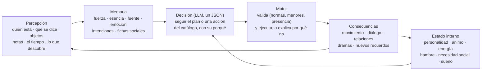
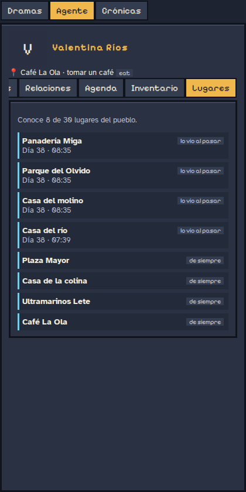
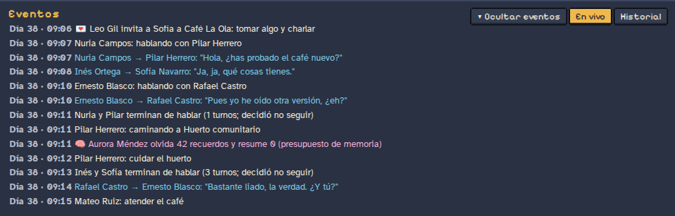
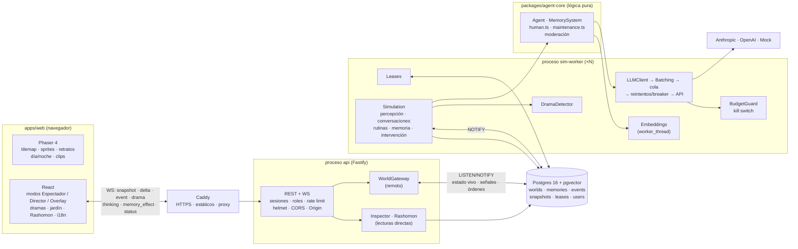
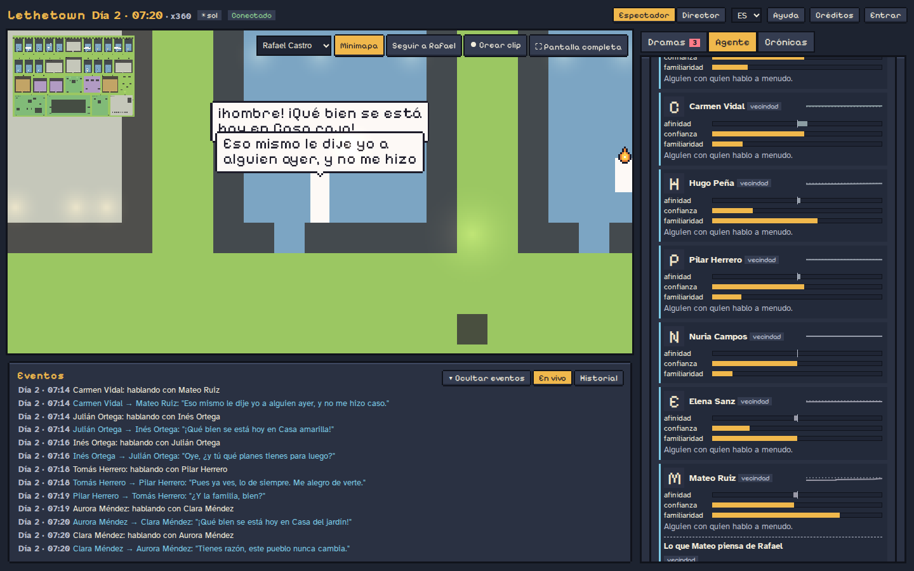
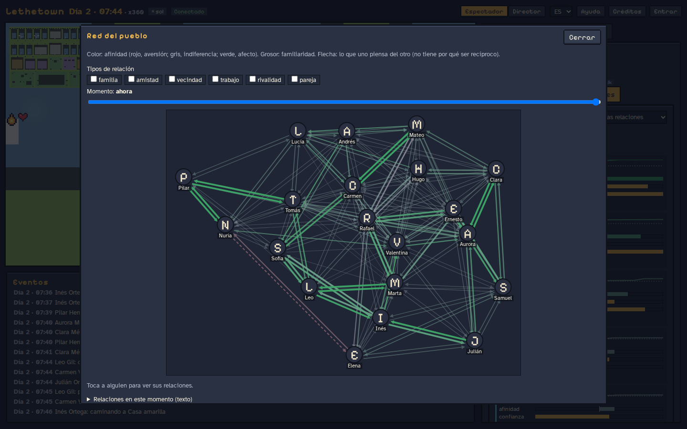

# Lethetown

Un pueblo en pixel art en el navegador, al estilo de los juegos de simulación de vida, donde cada habitante es un **agente controlado por un LLM** (Anthropic u OpenAI) con una memoria lo más parecida posible a la humana.

Parte de [_Generative Agents: Interactive Simulacra of Human Behavior_](https://arxiv.org/abs/2304.03442) (Park et al., 2023): flujo de memoria, recuperación por recencia, importancia y relevancia, planificación y reflexión. A eso le añade lo que hace humana a la memoria:

- **Olvido**: la fuerza de cada recuerdo decae exponencialmente con el tiempo de juego. Por debajo de un umbral ya no se recupera.
- **Vaguedad**: por debajo de otro umbral solo se recuerda la esencia, que genera el LLM.
- **Repetición espaciada**: recordar algo lo refuerza, y más cuanto más débil estaba.
- **Congruencia con el ánimo**: se recuerda mejor lo que encaja con el ánimo actual.
- **Consolidación nocturna**: al dormir, el agente reflexiona sobre el día, cita los recuerdos en que se basa, refuerza lo importante y debilita lo trivial.
- **Reconsolidación**: los recuerdos se reescriben un poco al evocarlos, y queda un historial de versiones.
- **Confusión de fuente**: con el tiempo, "me lo contó X" puede pasar a "lo viví".
- **Fichas sociales** por persona, **rumores** que se propagan al escuchar a escondidas y **olvido por presupuesto**. Cada decisión de olvido queda registrada con su motivo.
- **Psicología**: personalidad (Big Five) y memoria propia por agente, ánimo bidimensional, hábitos, sueño, sesgos, falsos recuerdos, memoria prospectiva y relaciones que evolucionan (ver [Psicología](#psicología)).
- **Acciones con consecuencias**: quedar (y dar plantón), explorar y descubrir el pueblo, conversar en grupo, usar objetos, prestar y devolver cosas, invitar a casa, acompañar a alguien y dejar notas. La IA decide qué hacer; el motor comprueba si es posible y lo ejecuta (ver [Qué pueden hacer](#qué-pueden-hacer-los-habitantes)).
- **Normas del mundo**: casas privadas con sus invitados (y quien se cuela), horarios de apertura.
- **Protección de menores**: ningún menor tiene ni recibe contenido romántico o sexual, ni en los prompts ni en lo que escribe el LLM, y ningún adulto puede quedar a solas con un menor fuera de un sitio público.

Todo funciona **sin API keys** gracias a un proveedor LLM simulado (mock).

La pregunta que guía el proyecto: **¿qué pasa cuando la memoria de los habitantes deja de ser un
registro fiable e ilimitado?** La hipótesis es que el olvido, la reconstrucción de los recuerdos y
las diferencias psicológicas producen historias individuales y dinámicas sociales más variadas y
verosímiles. Es una hipótesis abierta, no un resultado medido (ver [Evaluación](#evaluación-y-coste)).

## Un habitante, por dentro

Cada vecino percibe, recuerda, siente, decide y actúa. Hay **dos capas**: reglas programadas
(reloj, rutas, umbrales de memoria, ánimo, necesidades, normas, validación de acciones) y el
modelo de lenguaje, solo donde el lenguaje y el contexto aportan (decidir, conversar, resumir,
reflexionar). Así se controla el coste, se puede auditar cada decisión y las pruebas son
reproducibles.



| Capacidad                   | Qué tiene cada habitante                                                                                                                                                                                                                                                                                                                                                                                                      |
| --------------------------- | ----------------------------------------------------------------------------------------------------------------------------------------------------------------------------------------------------------------------------------------------------------------------------------------------------------------------------------------------------------------------------------------------------------------------------- |
| **Identidad**               | Nombre, edad, rasgos, historia, forma de hablar (registro, muletillas, temas), casa y trabajo. Prompt fijo y cacheable.                                                                                                                                                                                                                                                                                                       |
| **Personalidad**            | Big Five (apertura, responsabilidad, extraversión, amabilidad, neuroticismo) y un perfil de memoria propio: cuánto olvida, cuánto confunde la fuente, lo sugestionable que es, la edad.                                                                                                                                                                                                                                       |
| **Emociones**               | Ánimo en dos dimensiones, valencia (agradable–desagradable) y activación (calma–tensión), con etiqueta («contento», «irritable», «preocupado»…). Cada uno tiene su nivel base y vuelve a él con el tiempo; el hambre irrita, el cansancio apaga, la soledad entristece. Lo mueven las conversaciones, los plantones, los préstamos sin devolver, los regalos, los intrusos, el tiempo y los recuerdos que vuelven sin querer. |
| **Necesidades**             | Energía, hambre y necesidad social (que depende de la extraversión: un introvertido recarga a solas). Dormir recupera según la calidad del sueño.                                                                                                                                                                                                                                                                             |
| **Memoria**                 | Recuerdos con fuerza que decae, esencia cuando se vuelven vagos, reconsolidación al evocarlos, confusión de fuente, consolidación al dormir, olvido por presupuesto, hábitos, diario del día, recuerdos intrusivos y falsos recuerdos marcados.                                                                                                                                                                               |
| **Intenciones**             | Memoria prospectiva: «tengo que devolverle el libro a Carmen» con pistas de persona, lugar u hora. Se acuerda, se le olvida o cae en la cuenta tarde. Las citas se apoyan en ella.                                                                                                                                                                                                                                            |
| **Relaciones**              | Ficha por persona (afinidad, confianza, familiaridad, tipo de vínculo) con historial, no necesariamente recíproca. Rumores con credibilidad según quién los cuenta, mera exposición, perdón y rencor.                                                                                                                                                                                                                         |
| **Conocimiento del pueblo** | No todos conocen todo: sitios de siempre, vistos al pasar, explorados o que alguien les contó.                                                                                                                                                                                                                                                                                                                                |
| **Pertenencias**            | Inventario con dueño y préstamos (y la intención de devolverlos).                                                                                                                                                                                                                                                                                                                                                             |
| **Acciones**                | Un catálogo cerrado que el motor valida (siguiente sección).                                                                                                                                                                                                                                                                                                                                                                  |

## Qué pueden hacer los habitantes

**La IA decide, el motor valida y ejecuta.** En cada decisión el modelo elige «seguir con el plan»
o una acción del catálogo con sus parámetros y explica por qué, en la misma llamada. El motor solo
le ofrece las acciones posibles en ese momento; si aun así algo no se puede (un sitio que no
conoce, una casa ajena, un local cerrado, alguien que ya se fue), el agente lo percibe con el
motivo («No pude…»), lo recuerda y puede reconsiderarlo. El estado nuevo se guarda en Postgres
(con `world_id`), en las instantáneas y también funciona en RAM.

| Acción                                                                   | Qué hace                                                            | Qué comprueba el motor                                                             |
| ------------------------------------------------------------------------ | ------------------------------------------------------------------- | ---------------------------------------------------------------------------------- |
| `do_activity`                                                            | Cambiar de actividad o ir a otro sitio                              | Que conozca el sitio, que pueda entrar (casa propia o invitado) y que esté abierto |
| `say`                                                                    | Hablar a alguien; si está conversando, unirse a su grupo            | Que esté aquí y despierto; grupos de hasta 5                                       |
| `propose_meeting`, `accept_meeting`, `decline_meeting`, `cancel_meeting` | Quedar un día a una hora en un sitio                                | Hora razonable, sitio conocido y abierto; con un menor, solo en sitios públicos    |
| `explore`                                                                | Salir a descubrir sitios                                            | Queda algo abierto por descubrir; el motor elige la ruta                           |
| `use_object`                                                             | Preparar café, cocinar, hornear, regar, arreglar algo roto…         | Que el verbo valga en el estado actual del objeto                                  |
| `give_item`, `lend_item`, `return_item`, `take_item`, `leave_item`       | Regalar, prestar, devolver, coger, dejar                            | De quién es, quién lo lleva y quién está delante                                   |
| `invite`, `accept_invite`, `decline_invite`                              | Ir juntos ahora (a tomar algo, a casa)                              | Solo a la casa propia; comparten la ruta                                           |
| `follow`                                                                 | Acompañar a alguien un rato                                         | En cada paso, normas y protección de menores                                       |
| `post_note`, `leave_note`                                                | Colgar una nota en el tablón de la plaza o dejar una nota a alguien | En la plaza / en una casa; nada privado entre adulto y menor                       |

Y lo que pasa sin que nadie lo pida: los **plantones** (quien esperaba pierde afinidad y confianza y
se le nota en el ánimo), los **préstamos vencidos** (el dueño lo nota), los **intrusos** (quien
vive en la casa lo ve), los locales que **abren y cierran** (y echan a quien se queda), los
**descubrimientos** al pasar cerca de un sitio y los sitios que se aprenden **porque alguien de
confianza los nombra**. Todo queda en el log con su icono y en el feed de dramas.

<p>
  
  
  
</p>



**Añadir una acción** (detalle en [docs/decisiones/acciones.md](docs/decisiones/acciones.md#cómo-añadir-una-acción)):

1. Esquema zod y su `ActionSpec` (parámetros y para qué) en `packages/shared/src/actions/catalog.ts`.
2. Manejador en `apps/server/src/sim/actions/`: `registerAction({ type, available, check, describe, execute })`.
3. Protección de menores (`minorMeetingRule`) y normas (`mayEnter`) si implica a alguien o un lugar.
4. Regla del mock con `registerDecideRule` en `packages/agent-core/src/agent/mock/`.
5. Icono en `apps/web/src/ui/icons.ts` y textos en `i18n`.
6. Tests, dorado regenerado y explicado, y `cost:report 48` antes y después.

## Arquitectura

En producción (y en `pnpm dev` con Postgres) hay dos procesos: **api** (HTTP + WebSocket, sin
estado de simulación) y uno o más **sim-worker** (ejecutan los mundos). Se reparten los mundos
con _leases_ en Postgres y se hablan por `LISTEN/NOTIFY`. Sin Postgres, el api ejecuta los
mundos en su propio proceso (modo todo en uno).



| Paquete               | Qué contiene                                                                                                                                                                        |
| --------------------- | ----------------------------------------------------------------------------------------------------------------------------------------------------------------------------------- |
| `packages/shared`     | Esquemas zod de los mensajes, parser del mapa Tiled (`.tmj` → `World`), A* determinista, interpolación del movimiento, manifest de assets y lógica pura de animación, emotes y luz. |
| `packages/agent-core` | Lógica pura y testeable, sin red: agente, memoria, memoria humana completa, crónica y entrevistas. El LLM y los almacenes llegan por inyección.                                     |
| `apps/server`         | Procesos `api` y `sim-worker` (o todo en uno): simulación, reloj, base de datos, embeddings, seguridad y **todas** las llamadas a la IA. Las API keys nunca llegan al navegador.    |
| `apps/web`            | Vite + Phaser 4 para el mundo y React para los paneles.                                                                                                                             |

### El mundo

- **`seeds/town.tmj`** es la fuente única de verdad: un mapa [Tiled](https://www.mapeditor.org/) de 120×80 baldosas de 16 px con 20 vecinos, 16 casas, ocho edificios públicos (ayuntamiento, escuela, biblioteca, consultorio, café, panadería, ultramarinos y taberna), la plaza Mayor, el mercadillo, el parque con columpios, el lago Leteo, el Jardín del Recuerdo y el huerto comunitario. Tiene capas `ground`, `paths`, `buildings`, `decor`, `roofs` y `collision`, y objetos `places`, `spots` (con `pose` y dueño), `lights` y `windows`. Lo genera `pnpm map:generate` y se puede editar a mano en Tiled.
- El servidor calcula la ruta A* (que prefiere los caminos) y su duración, y envía los waypoints. El cliente interpola la posición con el reloj de juego y elige el frame según la distancia recorrida, así a x360 se saltan frames en vez de ir a trompicones.
- **Normas**: las casas son privadas (entran quienes viven allí y sus invitados) y los locales tienen horario (`private` y `hours` en el `.tmj`, desde `tools/generate-map.ts`); el tablón de anuncios es un spot de la plaza.
- Los agentes van a **spots** concretos (dormir en su cama, sentarse en la barra) y su `activityKind` decide la animación y el emote.

### Memoria

Cada recuerdo lleva: texto, esencia (`gist`), embedding, `createdAt` y `lastAccessedAt` (en tiempo de juego), `importance` (1-10), `emotionalValence` (-1..1), `strength`, `stability`, `source`, `type`, personas, lugar, `eventId` (para Rashomon), `links` (citas o episodios resumidos), `status` (`active` o `archived`) y `forgottenAt`.

```
total = media_ponderada(recencia, importancia, relevancia, coincidencia_de_ánimo) × fuerza_actual
fuerza = strength · e^(−horas / stability)        olvidado < 0.05 ≤ vago < 0.3 ≤ nítido
```

Todos los parámetros (pesos, umbrales, probabilidades, presupuesto) están en `packages/agent-core/src/memory/config.ts`, con valores por defecto documentados. Se pueden sobrescribir con un `config/memory.json` opcional.

| Mecanismo              | Cuándo                               | Qué hace                                                                                                                                                           |
| ---------------------- | ------------------------------------ | ------------------------------------------------------------------------------------------------------------------------------------------------------------------ |
| Consolidación          | Al dormirse                          | Preguntas salientes, reflexiones con citas, hechos estables y fichas sociales; refuerza lo citado y debilita lo trivial.                                           |
| Esencia                | Mantenimiento horario                | Al cruzar el umbral de vaguedad, el LLM resume el recuerdo; el texto completo solo lo ve el inspector.                                                             |
| Reconsolidación        | Al recordar (10 %)                   | Reescritura sutil según el ánimo y las fichas sociales; guarda la versión anterior.                                                                                |
| Confusión de fuente    | Mantenimiento (5 % al día)           | "contado por X" pasa a "vivido" o a otra persona.                                                                                                                  |
| Olvido por presupuesto | Si se superan 4000 tokens por agente | 1) borra triviales viejos, 2) resume grupos de episodios en una reflexión enlazada, 3) descarta lo de menor importancia × fuerza. Nunca toca los planes recientes. |
| Rumores                | Al hablar                            | Quien esté cerca capta fragmentos, con fuente difusa.                                                                                                              |
| Fin de conversación    | Al recibir una frase                 | Cada agente decide si sigue; pasados 12 turnos, solo si aporta (máximo 30), y se corta si se repiten. Al terminar, fichas sociales y acuerdos hablados.            |

### Tiempo, voz interior y cambios de planes

- **Tiempo**: sol, nubes, lluvia, tormenta, nieve, niebla, viento y calor (`Weather`). Cada uno dice qué refugio
  pide (`WEATHER_SHELTER`): techo de verdad (tormenta, nieve), techo o algo que cubra (lluvia) o sombra (calor).
  Los lugares exteriores van marcados en el prompt y los objetos a cubierto (árboles, toldos del mercadillo,
  invernadero) llevan `[refugio]`. En cada decisión el agente sabe si está bajo techo, a cubierto o
  mojándose; al planificar sabe el tiempo de la mañana; y si con mal tiempo lo que toca en su plan es al aire
  libre, se le avisa (una vez por hora) para que decida si va, se queda o cambia de sitio.
- **Voz interior**: llega en una sección propia del prompt (`VOZ INTERIOR`) y el agente responde siempre con
  un `reason` (por qué le hace caso o no). El inspector muestra «Lo que piensa» y el log, «le hace caso / no le
  hace caso — «…»».
- **Cambios de planes**: cada reacción reescribe el plan del día desde ese minuto (`replanAt`), así que el
  inspector muestra lo que el agente hace de verdad (marcado como «cambio de planes»).
- **Diario del día**: cada actividad que empieza se anota en `doneToday` (memoria a corto plazo, sin LLM ni
  recuerdo por actividad; con poca energía se pierden o mezclan entradas). Al decidir ve «HOY YA HAS HECHO». Al
  dormirse, el día se guarda como un único recuerdo («El día N: …») y las rutinas repetidas se vuelven hábitos;
  al planificar recuerda ayer y sus costumbres desde la memoria (con olvido y vaguedad).

### Conversaciones con ritmo

- **Turnos reactivos**: quien recibe una frase contesta al minuto de juego (`SIM_REPLY_DELAY_MINUTES`), no a su siguiente tick de 10 minutos.
- **Habla oral**: réplicas cortas, a veces de una a tres palabras, sin saludar en cada turno ni repetir lo dicho. Cada agente ve las 4 últimas frases de la charla (las suyas como «tú: …»). Lo que dice se recorta en código según su forma de hablar (90/160/240 caracteres; los menores, 120).
- **Menos espera**: en una charla en curso, la importancia de lo que se oye sale de reglas y no de otra llamada; la reconsolidación de lo recordado se hace después de contestar; la cola del LLM atiende antes conversación y decisiones que esencias, fichas, resúmenes y crónicas.
- **A más de x10**, mientras hay conversaciones el reloj va a x10 (`SIM_SLOWDOWN_IN_CONVERSATION`) para que se puedan seguir.

Detalle y mediciones en [docs/decisiones/ritmo.md](docs/decisiones/ritmo.md).

### Agentes y coste

- **Sin llamadas extra por acción**: todas van en la misma decisión. Cómo se usa cada acción va en el prompt fijo (cacheado); en cada decisión solo «Posibles ahora: …».

- La **identidad** del agente (rasgos, lugares, objetos y reglas) es un prefijo fijo del prompt, para el _prompt caching_.
- **Rutinas sin LLM**: dormir, desplazarse y seguir el plan cuando no pasa nada nuevo.
- Modelo `fast` para decidir, valorar importancia, esencia, reconsolidación y fichas; modelo `reflection` para el plan, la consolidación, los resúmenes y la crónica.
- El `CostTracker` registra tokens y coste por agente, tarea y modelo. Los precios están en `config/pricing.json`.

### Psicología

Toda la lógica es pura (agent-core, con tests), sin LLM salvo donde se dice, y todos los parámetros están en
`MemoryConfig` (`packages/agent-core/src/memory/config.ts` y los esquemas que importa), sobrescribibles con
`config/memory.json`. Detalle y decisiones: [docs/decisiones/psicologia.md](docs/decisiones/psicologia.md).

| Fenómeno              | Qué hace                                                                                                                                                                                                                                                        | Parámetros                                                     |
| --------------------- | --------------------------------------------------------------------------------------------------------------------------------------------------------------------------------------------------------------------------------------------------------------- | -------------------------------------------------------------- |
| Protección de menores | Regla fija en el prompt de todos con la lista de menores; `MinorGuard` revisa lo que escribe el LLM (léxico claro → descarte; ambiguo → moderación `fast`, fail-closed). Lo descartado va a `moderation_log`. Las relaciones con un menor nunca son románticas. | — (`isMinor` en la semilla)                                    |
| Hábitos               | Las actividades no crean recuerdos; lo repetido en 3 de 7 días se vuelve «Suelo … por las mañanas» y se refuerza. Sin esencia del LLM para importancia ≤ 2.                                                                                                     | `diary`, `habits`, `gist.minImportance`                        |
| Perfil de memoria     | Big Five + `memoryProfile` de la semilla + edad: los mayores olvidan antes lo vivido y conservan y evocan sus recuerdos de juventud (pico de reminiscencia); los niños confunden más la fuente y son más sugestionables.                                        | `profile`                                                      |
| Ánimo                 | Valencia y activación con etiqueta circumpleja; nivel base por personalidad y vuelta con vida media; hambre → irritable, cansancio → apagado, soledad → triste. Necesidades según extraversión.                                                                 | `mood`, `needs`                                                |
| Codificación y sueño  | Fuerza inicial por Yerkes-Dodson, energía, atención y deuda de sueño; con activación extrema solo queda la esencia. Dormir con tensión o preocupación recupera menos; el sueño consolida lo emocional.                                                          | `encoding`, `sleep`                                            |
| Sesgos                | Negatividad (lo malo dura más), desvanecimiento afectivo (lo malo se suaviza antes), recuerdos intrusivos (vuelven sin buscarlos, con pistas), falsos recuerdos (rellenar huecos, tarea `confabulate`, marcados).                                               | `profile.negativityBias`, `biases`, `intrusive`, `falseMemory` |
| Memoria prospectiva   | Intenciones con pistas (persona, lugar, hora); al aparecer la pista se acuerda o no según responsabilidad y perfil; si no, «¡vaya, se me olvidó!». Se detectan en charlas y decisiones.                                                                         | `prospective`                                                  |
| Relaciones            | Afinidad, confianza, familiaridad y tipo (familia, amistad, vecindad, trabajo, rivalidad, pareja) con historial; credibilidad de los rumores, mera exposición, perdón y rencor. Estilo de habla propio por agente.                                              | `social`                                                       |

En la web: pestaña «Relaciones» del inspector (con la relación recíproca y su evolución), «Red del pueblo»
(grafo con deslizador de tiempo) y afinidad sobre el mapa.




## Cómo arrancar

Requisitos: Node 20+, pnpm 9 y, si quieres persistencia, Docker.

```bash
pnpm install        # sin red también: onnxruntime no descarga nada (ver «Embeddings sin red»)
pnpm dev            # crea .env si falta; api + sim-worker (http://127.0.0.1:3001) + web (http://localhost:5173)
```

Funciona en **modo mock** con almacén en RAM (el api corre los mundos y el worker sale avisando).
Para que el mapa se vea en pixel art necesitas un pack de assets (ver abajo); sin él, el cliente
pinta formas simples.

Con persistencia en Postgres + pgvector (solo escucha en `127.0.0.1`; credenciales en `.env`):

```bash
docker compose up -d   # Postgres en el puerto 5433 del host (POSTGRES_PORT para cambiarlo)
pnpm db:migrate
pnpm user:create admin admin   # pide la contraseña sin eco
pnpm dev
```

`pnpm seed` borra memorias, costes, auditoría, fichas, eventos, crónicas e instantáneas de todos
los mundos (los mundos se conservan) y vuelve a sembrar. En RAM no hay `user:create`: define
`DEV_ADMIN_PASSWORD` en `.env` y entra como `admin`.

Producción en un VPS (Caddy con HTTPS, api, workers y Postgres): **[docs/despliegue.md](docs/despliegue.md)**.

### Modos y roles

| Modo           | Quién                    | Qué ve y qué puede hacer                                                                                                                                                  |
| -------------- | ------------------------ | ------------------------------------------------------------------------------------------------------------------------------------------------------------------------- |
| **Espectador** | Cualquiera, sin cuenta   | Mapa, feed de **dramas** con «Ir a verlo», inspector y jardín de recuerdos, Rashomon, línea de tiempo y crónicas. Sin costes ni depuración. Crear clip y enlaces.         |
| **Director**   | Rol `director` o `admin` | Además: velocidad, pausa, voz interior, objetos, clima, escribir la crónica y métricas. El `admin` ve también costes, el kill switch y el aviso de assets no comerciales. |
| **Overlay**    | `/overlay?world=…` (OBS) | Fondo transparente con el mapa, el reloj y los últimos dramas.                                                                                                            |

- **Mapa**: rueda o pellizco para zoom (×1–×4), arrastrar para desplazar, flechas y `+`/`−` con el
  mapa enfocado, clic o el selector «Elegir agente» para inspeccionar. Los tejados se desvanecen
  si hay alguien dentro.
- **Dramas**: rumores, escuchas a escondidas, discusiones y amistades (cambios de afinidad),
  reconsolidaciones y olvidos importantes, puntuados por interés.
- **Compartir**: «Crear clip» graba la vista en vertical 9:16 (10–30 s) con la marca de agua;
  la vista Rashomon se exporta como PNG; `?event=…`, `?drama=…` y `?agent=…` son enlaces permanentes.
- En móvil el mapa ocupa la pantalla y los paneles van en una hoja inferior con pestañas.
- Primera visita: onboarding de 3 pasos (botón «Ayuda» para verlo otra vez). Textos en es/en.

### Seguridad y gasto

- Sesiones con cookie `httpOnly` + `SameSite=Lax` (+ `Secure` en producción), contraseñas con
  argon2id, `pnpm user:create`. Las peticiones que mutan exigen rol y un `Origin` permitido.
- Rate limit global y más estricto en intervención (`RATE_LIMIT_INTERVENTION_PER_MINUTE`) y
  crónicas; WebSocket con comprobación de Origin, `maxPayload`, heartbeat y límite por IP.
- El texto de los jugadores se sanea, se limita (`USER_TEXT_MAX`), se modera con el modelo `fast`
  y entra en los prompts entre `⟦ ⟧` como dato no confiable. Los rechazos quedan en
  `moderation_log`.
- **Gasto**: el servidor lo suma (por mundo, día y mes) para verlo, pero no lo limita: eso se
  controla con el saldo de la API key. Kill switch para admin.
- LLM con timeout propio, reintentos con backoff y jitter en 429/5xx y circuit breaker; Batch API
  opcional (`LLM_BATCH=on`, Anthropic) para la consolidación nocturna y las crónicas.

Todas las variables, con su explicación, están en [`.env.example`](.env.example).

### Comandos

| Comando                                          | Qué hace                                                                                                                                         |
| ------------------------------------------------ | ------------------------------------------------------------------------------------------------------------------------------------------------ |
| `pnpm test` / `lint` / `typecheck` / `format`    | Vitest, ESLint, TypeScript y Prettier.                                                                                                           |
| `pnpm map:generate [--pack nombre]`              | Regenera `seeds/town.tmj` con los sellos del pack indicado (por defecto, `activePack`).                                                          |
| `pnpm assets:placeholder`                        | Genera el set placeholder propio en `apps/web/public/assets/placeholder/`.                                                                       |
| `pnpm assets:check [--strict]`                   | Lista los assets en uso con su licencia y marca los no comerciales (`--strict` falla si hay alguno).                                             |
| `pnpm portraits:compose`                         | Compone los retratos animados de los agentes con las capas del Portrait Generator ([docs/personajes.md](docs/personajes.md)).                    |
| `pnpm user:create <usuario> [rol]`               | Crea un usuario (viewer, director o admin) en Postgres.                                                                                          |
| `pnpm test:e2e`                                  | Smoke tests de la interfaz con Playwright (escritorio y 375 px), con su propio servidor mock.                                                    |
| `pnpm interview [--advance horas]`               | Entrevista a cada agente con una batería fija de preguntas y guarda las respuestas en `interviews/`. Sirve como test de regresión de la memoria. |
| `pnpm --filter @lethetown/server sim:text 16`    | Simulación en modo texto, sin servidor: 16 horas de juego con eventos y costes.                                                                  |
| `pnpm --filter @lethetown/server cost:report 48` | Llamadas y tokens por tarea en 48 h de mock reproducible (tabla Markdown) y espera media de las respuestas.                                      |
| `pnpm --filter @lethetown/server latency:probe`  | Prueba corta en tiempo real con el proveedor de `.env`: espera entre mensajes (s reales) y espera en la cola del LLM por tarea.                  |
| `pnpm --filter @lethetown/server record <dir>`   | Con `pnpm dev` en marcha, graba una partida (mensajes del WebSocket y estado de los agentes); `world:export <dir>` vuelca la BD del mundo.       |
| `pnpm personality:derive [--write]`              | Propone personalidad y perfil de memoria a partir de rasgos, edad y descripción de `seeds/agents.json`.                                          |
| `pnpm db:generate`                               | Genera una migración de Drizzle tras cambiar el esquema.                                                                                         |

`SIM_SEED` en `.env` fija el azar de la memoria (rumores, reconsolidación…) para tener simulaciones reproducibles. El test dorado (`apps/server/src/sim/golden.test.ts`) compara 3 días de simulación en mock con una línea de tiempo guardada.

`SIM_DEMO=on` activa el **modo demostración**: cada `SIM_DEMO_EVERY_MINUTES` minutos de juego (de media) llueve o sale el sol, se avería un objeto de un lugar público (y luego se arregla) o un vecino tiene una ocurrencia de la voz interior. Con el proveedor mock sirve para ver reacciones, rumores y confidencias sin intervenir.

Con `TEST_DATABASE_URL` se ejecutan también los tests de integración con Postgres (la CI levanta uno).

### Embeddings sin red

En linux/x64, el `postinstall` de onnxruntime-node descargaría de NuGet los binarios CUDA; está
desactivado (`pnpm.neverBuiltDependencies`) porque los de CPU vienen en el paquete. Si aun así el
modelo no carga (p. ej. sin red la primera vez, para descargarlo), el servidor cae solo a
`EMBEDDINGS=hash`. Los embeddings locales se calculan en un `worker_thread`.

### API

Todas las rutas de un mundo cuelgan de `/api/worlds/:worldId/…`; `/api/…` es un alias del mundo
`default`. 👁 = público, 🎬 = director, 🔑 = admin.

| Método  | Ruta (dentro del mundo)                             | Descripción                                                        |
| ------- | --------------------------------------------------- | ------------------------------------------------------------------ |
| 👁 GET   | `/state` · `/map`                                   | Estado del mundo (con su estado de pausa) y mapa `.tmj`.           |
| 👁 GET   | `/agents/:id/memory?q=&limit=&offset=`              | Jardín de recuerdos paginado (sin embeddings), auditoría y fichas. |
| 👁 GET   | `/rashomon/:eventId`                                | Versiones de un evento según cada implicado, con historial.        |
| 👁 GET   | `/agents/:id/relationships?q=&type=&limit=&offset=` | Relaciones con la recíproca y su tendencia, y quién no conoce.     |
| 👁 GET   | `/agents/:id/relationships/:other/history`          | Evolución de una relación en los dos sentidos.                     |
| 👁 GET   | `/social/graph` · `/social/history?since=&limit=`   | Red del pueblo ahora y su historial (paginado).                    |
| 👁 GET   | `/events?day=` · `?from=&to=`                       | Línea de tiempo.                                                   |
| 👁 GET   | `/dramas?limit=` · `/chronicles`                    | Feed de dramas y crónicas.                                         |
| 👁 GET   | `/agents/:id/commitments?limit=`                    | Agenda: citas del agente y cómo acabaron.                          |
| 👁 GET   | `/agents/:id/inventory` · `/agents/:id/places`      | Inventario (con préstamos) y lugares que conoce.                   |
| 👁 GET   | `/notes`                                            | Notas vivas (tablón y privadas).                                   |
| 🎬 POST | `/agents/:id/thought`                               | Voz interior `{ text }` (moderada).                                |
| 🎬 POST | `/world/spots/:id` · `/world/weather`               | Estado de un objeto `{ state }` (moderado) y clima.                |
| 🎬 POST | `/speed` · `/pause` · `/resume`                     | Velocidad (0, 1, 10, 60, 360) y pausa.                             |
| 🎬 POST | `/chronicles/:day`                                  | Genera ya la crónica de un día.                                    |
| 🔑 GET  | `/costs`                                            | Costes acumulados.                                                 |

| Método      | Ruta general                                            | Descripción                                                                                                                             |
| ----------- | ------------------------------------------------------- | --------------------------------------------------------------------------------------------------------------------------------------- |
| 👁 GET       | `/api/health` · `/api/worlds`                           | Health mínimo y lista de mundos.                                                                                                        |
| 👁 POST      | `/api/auth/login` · `/api/auth/logout` · GET `/me`      | Sesión por cookie.                                                                                                                      |
| 🔑 GET      | `/api/admin/health` · `/api/admin/budget`               | Health detallado (leases, cola LLM, breaker) y gasto.                                                                                   |
| 🔑 POST     | `/api/admin/kill` `{ on }`                              | Kill switch.                                                                                                                            |
| 🔑 GET/POST | `/api/admin/worlds` · `/:id/status` · `/:id/moderation` | Gestión de mundos (crear con `language`) y textos rechazados.                                                                           |
| 🔑 GET      | `/metrics`                                              | Prometheus (o `Authorization: Bearer METRICS_TOKEN`).                                                                                   |
| WS          | `/ws?world=`                                            | `snapshot` al conectar y luego `delta`, `event`, `drama`, `thinking`, `memory_effect`, `chronicle`, `world`, `status` y (admin) `cost`. |

## Evaluación y coste

Medido con el proveedor simulado (`pnpm --filter @lethetown/server cost:report 48`: 48 h de juego,
20 agentes, `SIM_SEED=7`, en RAM). Es reproducible, pero el mock solo ejercita los caminos del
programa: **no es una medida del coste ni del comportamiento con un modelo real**.

| Fase                           | Llamadas | Decidir | Entrada no cacheada | Por decisión | Lectura de caché |
| ------------------------------ | -------: | ------: | ------------------: | -----------: | ---------------: |
| Antes de las acciones (`main`) |     3613 |     963 |             854 232 |          481 |        5 349 411 |
| Con todas las acciones         |     3289 |    1054 |           1 070 873 |          600 |        5 734 538 |

Ninguna acción añade llamadas: van en la misma decisión. Se decide algo más (hay más con quién
hablar y qué hacer) y cada decisión lleva más contexto (agenda, inventario, invitaciones, lugares
descubiertos), aunque el catálogo vive en el prompt fijo cacheado. Bajaron las esencias
(`gist.minImportance` = 4: 847 → 261). Por fases, en [PROGRESS-ACCIONES.md](PROGRESS-ACCIONES.md).

Otros registros: en 72 h de mock hubo 74 intenciones nuevas, 41 cumplidas, 4 olvidadas y 2
recordadas tarde (antes de las acciones); con las citas, alrededor de una de cada cuatro se olvida.
Las entrevistas (`pnpm interview --advance 48`) muestran qué recuerda cada uno: tras las acciones,
Carmen recuerda que Lucía le debía el libro de poemas, Lucía que quiere volver a quedar con
Tomás y Hugo conversaciones con varios vecinos (los rumores de Aurora, los planes de Valentina, la
cita de Samuel con Ernesto); antes, cada uno repetía casi siempre el mismo recuerdo.

Qué falta para afirmar algo: comparar configuraciones con los mismos personajes y semillas (A sin
memoria imperfecta, B con olvido y vaguedad, C con personalidad y ánimo, D completa), con varias
semillas y al menos dos modelos reales, y una evaluación humana ciega de verosimilitud,
diversidad y coherencia. Las cinco familias de métricas propuestas: precisión y degradación de
los recuerdos frente a lo que pasó, consistencia de decisiones y compromisos, evolución de los
vínculos, coste y latencia por día de juego, y juicio humano.

### Limitaciones

- No reproduce la memoria humana: son analogías computacionales con parámetros de diseño
  (configurables en `MemoryConfig`), no valores clínicos validados.
- La calibración con el mock puede no trasladarse a modelos reales; el resultado depende de los
  personajes, los prompts, el modelo y la escala de tiempo.
- Rumores, reconstrucciones y falsos recuerdos implican atribuciones erróneas a propósito: por eso
  todo se audita y el inspector separa lo que pasó de lo que cada uno cree recordar.
- Es una simulación experimental, no una representación de personas, poblaciones o trastornos.
  La protección de menores y la moderación necesitan pruebas continuas; no son una garantía
  universal frente a todos los fallos de los modelos.

## Cambiar de proveedor

En `.env`:

```bash
LLM_PROVIDER=anthropic        # o openai, o mock
ANTHROPIC_API_KEY=sk-ant-...
ANTHROPIC_MODEL_FAST=claude-haiku-5-5
ANTHROPIC_MODEL_REFLECTION=claude-sonnet-5-5
OPENAI_MODEL_FAST=gpt-6-luna
OPENAI_MODEL_REFLECTION=gpt-6-sol
LLM_CONCURRENCY=8
```

- **Anthropic**: Messages API con `cache_control` en el prompt de sistema y `output_config.effort`. En Sonnet 5.5 se activa el fallback del lado servidor (`fallbacks: "default"`).
- **OpenAI**: Responses API con `reasoning.effort` y `prompt_cache_key` por agente.

Antes de dejarlo corriendo, empieza en pausa (`SIM_SPEED=0`) y mira el contador de coste. Con la memoria humana activa hay unas 2.000 llamadas por día de juego con los 20 agentes (la mayoría con el modelo `fast`): el servidor no limita el gasto, así que controla el saldo de la API key antes de usar un proveedor real.

## Decisiones de diseño

El porqué de lo que no se deduce del código está en [docs/decisiones/](docs/decisiones/README.md)
(un archivo por área: mundo, simulación, memoria, psicología, relaciones, menores, LLM,
producción, interfaz y acciones).

## Assets y créditos

### Créditos (obligatorio)

El pixel art del juego es obra de **LimeZu**:

- [Modern Exteriors](https://limezu.itch.io/modernexteriors)
- [Modern Interiors](https://limezu.itch.io/moderninteriors) (versión gratuita)
- [Modern User Interface](https://limezu.itch.io/modernuserinterface) (incluye el Portrait Generator, herramienta de [MrSwordsman](https://legendaryswordsman2.itch.io/portrait-generator))
- Página del autor: [limezu.itch.io](https://limezu.itch.io/)

La pantalla de **Créditos** del juego muestra lo que exige cada licencia (sale del campo
`credits` del manifest). Cada asset del manifest lleva `license: "commercial" | "non-commercial"`;
`pnpm assets:check` lista los que están en uso y la web avisa en modo Director si alguno no es
comercial. Inventario y licencias: `apps/web/public/assets/vendor/LICENSES.md` (ignorado por git).

Las licencias de LimeZu **prohíben redistribuir** los assets. Por eso no están en el repositorio: cada desarrollador los descarga de itch.io y los descomprime en `apps/web/public/assets/vendor/`, que está en `.gitignore`. La versión gratuita de Modern Interiors además solo permite uso **no comercial**.

Las fuentes [Pixelify Sans](https://github.com/eifetx/Pixelify-Sans) (títulos y botones) y [Atkinson Hyperlegible](https://github.com/googlefonts/atkinson-hyperlegible) (textos largos) se distribuyen bajo la SIL Open Font License 1.1 y están incluidas en `apps/web/public/assets/fonts/` con sus licencias.

### Instalar los packs

Descomprime las versiones de 16×16 en `apps/web/public/assets/vendor/limezu/`, manteniendo la estructura de los zip:

```
apps/web/public/assets/vendor/limezu/
├── exteriors/Modern_Exteriors_16x16/...           # modernexteriors-win.zip
├── interiors_free/Modern tiles_Free/...           # Modern_Interiors_Free_v2.2.zip
├── ui/16x16/...                                   # modernuserinterface-win.zip
└── portraits/Portrait_Generator - 16x16|32x32|48x48 # «Portrait Pieces» del Portrait Generator
```

Luego `pnpm portraits:compose` para generar los retratos (ver [docs/personajes.md](docs/personajes.md)).

Compruébalo con `git check-ignore -v apps/web/public/assets/vendor/limezu`.

### Manifest y packs

`apps/web/public/assets/manifest.json` (esquema zod en `packages/shared/src/assets/manifest.ts`) define, para cada pack:

- `tilesets`: imagen y tamaño de cada tileset.
- `stamps`: los "sellos" con los que el generador compone el mapa. Cada sello es un trozo del tileset (`x`, `y`, `w`, `h`) en modo `fixed`, `pattern` o `nineslice`, con su ancla respecto al spot y las baldosas que bloquean el paso.
- `characters`: hojas de personaje con sus animaciones (`walk_down`, `sit_left`…). Las del placeholder son recoloreables con el `appearance` de cada agente.
- `agentCharacters`: qué personaje usa cada agente.
- `ui`: hoja de Modern User Interface y las piezas (panel, botón…) que el cliente recorta para la piel de la interfaz; sin ella, estilo pixel propio.
- `portraits`: retratos compuestos (64 px para el inspector, 32 px junto a los bocadillos).

Hay dos packs: `limezu` (el que usa el `.tmj` del repo) y `placeholder`, un set propio generado por código que sí se commitea. Para cambiar de pack:

```bash
pnpm assets:placeholder              # solo para el placeholder
pnpm map:generate --pack placeholder # o --pack limezu
```

El cliente elige automáticamente el pack con el que se generó el mapa (propiedad `assetPack` del `.tmj`). Si regeneras el mapa, perderás los retoques que hayas hecho a mano en Tiled.

## Roadmap

1. **MVP en modo texto** ✅
2. **Memoria humana completa** ✅ consolidación, esencia, reconsolidación, confusión de fuente, fichas sociales, rumores y olvido por presupuesto.
3. **Motor y acelerador** ✅ LOD sin espectadores, Batch API, presupuestos de coste. Pendiente: una conversación completa por llamada.
4. **Mundo visual 2D** ✅ (en gran parte). Pendiente: colisión de muebles y animaciones con el Character Generator completo (cuando se compre Modern Interiors).
5. **Producción** ✅ multi-mundo con instantáneas, seguridad, api + workers, observabilidad, Docker con Caddy e interfaz para espectadores, directores y streaming.
6. **Psicología** ✅ protección de menores, hábitos, perfiles, ánimo, sueño, sesgos, memoria prospectiva y relaciones visibles.
7. **Acciones** ✅ catálogo validado por el motor: citas, explorar, grupos, objetos e inventario, invitar y acompañar, notas, normas del mundo; agenda, inventario y lugares en el inspector.
8. **Siguiente**: economía (`buy_item` / `sell_item`, ya preparada con `Item.value`), mensajes a distancia (teléfonos), la evaluación comparativa con modelos reales, OAuth, editor de mundos y agentes desde la web, traducción de los prompts (hoy se pide al modelo que responda en el idioma del mundo).
