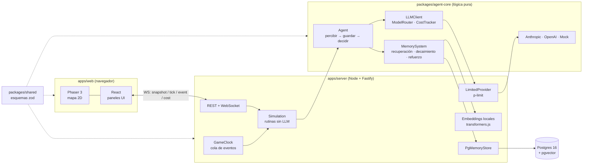

# Lethetown

Un pueblo en el navegador, al estilo de los juegos de simulación de vida, donde cada habitante es un **agente controlado por un LLM** (Anthropic o OpenAI) con una memoria lo más parecida posible a la humana.

Parte de [_Generative Agents: Interactive Simulacra of Human Behavior_](https://arxiv.org/abs/2304.03442) (Park et al., 2023): flujo de memoria, recuperación por recencia, importancia y relevancia, planificación y reflexión. A eso le añade lo que hace humana a la memoria:

- **Olvido**: la fuerza de cada recuerdo decae exponencialmente con el tiempo de juego. Por debajo de un umbral ya no se recupera.
- **Vaguedad**: por debajo de otro umbral solo se recuerda la esencia.
- **Repetición espaciada**: recordar algo lo refuerza, y más cuanto más débil estaba.
- **Congruencia con el ánimo**: se recuerda mejor lo que encaja con el ánimo actual.
- _(fase 2)_ **Consolidación** nocturna, **reconsolidación** (los recuerdos cambian al evocarlos), **confusión de fuente** y **fichas sociales**.

> Estado actual: **fase 1, esqueleto funcional**. Funciona sin API keys gracias a un proveedor LLM simulado.

## Arquitectura



| Paquete               | Qué contiene                                                                                                                    |
| --------------------- | ------------------------------------------------------------------------------------------------------------------------------- |
| `packages/shared`     | Esquemas zod y tipos de todo lo que viaja entre cliente y servidor.                                                             |
| `packages/agent-core` | Lógica pura y testeable, sin red. El LLM, el almacén y los embeddings le llegan por inyección de dependencias.                  |
| `apps/server`         | Simulación, reloj de juego, base de datos, embeddings y **todas** las llamadas a la IA. Las API keys nunca llegan al navegador. |
| `apps/web`            | Vite + Phaser 3 para el mapa y React para los paneles.                                                                          |

### Memoria

Cada recuerdo lleva: texto, embedding, `createdAt` y `lastAccessedAt` (en tiempo de juego), `importance` (1-10), `emotionalValence` (-1..1), `strength` (0..1), `stability` (horas), `source` (`vivido`, `contado por X` o `inferido`), `type` (`observation`, `reflection`, `plan` o `semantic`), personas implicadas y lugar.

**Puntuación de recuperación**:

```
total = media_ponderada(recencia, importancia, relevancia, coincidencia_de_ánimo) × fuerza_actual

recencia    = 0.995 ^ horas_desde_último_acceso
importancia = importance / 10
relevancia  = max(0, coseno(embedding, consulta))
ánimo       = 1 − |valence − ánimo_actual| / 2
fuerza      = strength · e^(−horas / stability)
```

- `fuerza < 0.05` → **olvidado**: no se recupera, aunque el inspector lo sigue mostrando.
- `fuerza < 0.3` → **vago**: el agente solo ve la esencia (`gist`).
- Al recuperar un recuerdo, su fuerza sube hacia 1 y su estabilidad se multiplica, con un bonus si estaba débil.
- La **memoria de trabajo** guarda unos 7 elementos y es lo único de la memoria que entra en el prompt.

### Agentes y coste

- La **identidad** del agente (rasgos, descripción, lugares, reglas) forma un prefijo fijo del prompt para aprovechar el _prompt caching_. Lo variable (hora, percepciones, memoria de trabajo) va detrás.
- **Rutinas triviales** sin LLM: dormir, desplazarse y seguir el plan cuando no pasa nada nuevo. El LLM solo se llama para planificar el día (modelo `reflection`) y cuando hay algo que percibir: valorar su importancia y decidir (modelo `fast`).
- El `CostTracker` registra los tokens de entrada, salida y caché por llamada, y los agrega por agente, por tarea y por modelo según `config/pricing.json`. Con Postgres, además, guarda cada llamada en `llm_calls`.

## Cómo arrancar

Requisitos: Node 20+, pnpm 9 y, si quieres persistencia, Docker.

```bash
pnpm install
pnpm dev            # crea .env si falta; servidor (http://127.0.0.1:3001) + web (http://localhost:5173)
```

Sin más pasos funciona en **modo mock** y con almacén en RAM. La primera vez descarga el modelo de embeddings (~25 MB). Si no hay red, usa embeddings hash automáticamente.

Con persistencia en Postgres + pgvector:

```bash
docker compose up -d   # Postgres en el puerto 5433 del host (POSTGRES_PORT para cambiarlo)
pnpm db:migrate
pnpm seed              # borra memorias y costes y vuelve a sembrar seeds/agents.json
pnpm dev
```

Otros comandos:

| Comando                                        | Qué hace                                                                                         |
| ---------------------------------------------- | ------------------------------------------------------------------------------------------------ |
| `pnpm test`                                    | Tests de Vitest (agent-core y reloj del servidor).                                               |
| `pnpm lint` / `pnpm typecheck` / `pnpm format` | ESLint, TypeScript y Prettier.                                                                   |
| `pnpm --filter @lethetown/server sim:text 16`  | Simulación en **modo texto**, sin servidor: avanza 16 horas de juego e imprime eventos y costes. |
| `pnpm db:generate`                             | Genera una migración de Drizzle tras cambiar `apps/server/src/db/schema.ts`.                     |

### API

| Método | Ruta                               | Descripción                                                                                                 |
| ------ | ---------------------------------- | ----------------------------------------------------------------------------------------------------------- |
| GET    | `/api/state`                       | Mundo, reloj y estado de los agentes.                                                                       |
| GET    | `/api/agents/:id/memory?q=&limit=` | Memoria de trabajo y recuerdos puntuados contra `q` (por defecto, la acción actual). Incluye los olvidados. |
| GET    | `/api/costs`                       | Costes acumulados (total, por agente, tarea y modelo).                                                      |
| POST   | `/api/speed`                       | `{ "speed": 0 \| 1 \| 10 \| 60 \| 360 }`                                                                    |
| WS     | `/ws`                              | El servidor envía `snapshot`, `tick`, `event` y `cost`. El cliente envía `setSpeed` y `requestSnapshot`.    |

## Cambiar de proveedor

En `.env`:

```bash
LLM_PROVIDER=anthropic        # o openai, o mock
ANTHROPIC_API_KEY=sk-ant-...
# Modelos por tipo de tarea (valores por defecto):
ANTHROPIC_MODEL_FAST=claude-haiku-5-5
ANTHROPIC_MODEL_REFLECTION=claude-sonnet-5-5
OPENAI_MODEL_FAST=gpt-6-luna
OPENAI_MODEL_REFLECTION=gpt-6-sol
LLM_CONCURRENCY=4             # llamadas simultáneas máximas
```

- **Anthropic**: Messages API con `cache_control` en el prompt de sistema y `output_config.effort` (`low` para las tareas _fast_, `medium` para _reflection_). En los modelos que lo admiten (Sonnet 5.5) se activa el fallback del lado servidor (`fallbacks: "default"`), que reenvía la petición a otro modelo si la rechaza un clasificador de seguridad.
- **OpenAI**: Responses API con `reasoning.effort` y `prompt_cache_key` por agente.

Si cambias de modelo, añade su precio a `config/pricing.json`. Mientras no lo tenga, se contabiliza a 0 $ y aparece en `unpricedModels` de `/api/costs`.

## Roadmap

1. **MVP en modo texto** _(en curso)_: esqueleto, simulación mínima, memoria con olvido, vaguedad y refuerzo, proveedores y costes.
2. **Memoria humana completa**: consolidación nocturna y reflexión, compresión de detalle a esencia, reconsolidación, confusión de fuente y fichas sociales por persona. Las interfaces ya existen en `packages/agent-core/src/memory/future.ts`.
3. **Motor y acelerador**: nivel de detalle (LOD) para agentes lejanos o aburridos, Batch API para tareas no urgentes (reflexión nocturna) y presupuestos de coste.
4. **Mundo visual 2D**: tilemap, sprites, animaciones, objetos interactivos y cámara.
5. **Pulido**: guardado y carga de partidas, editor de agentes, intervención del jugador y rendimiento.
