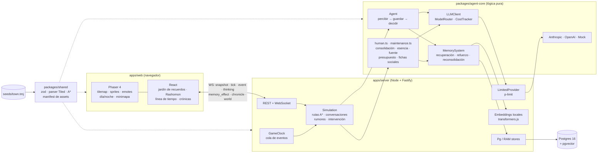

# Lethetown

Un pueblo en pixel art en el navegador, al estilo de los juegos de simulación de vida, donde cada habitante es un **agente controlado por un LLM** (Anthropic u OpenAI) con una memoria lo más parecida posible a la humana.

Parte de [_Generative Agents: Interactive Simulacra of Human Behavior_](https://arxiv.org/abs/2304.03442) (Park et al., 2023): flujo de memoria, recuperación por recencia, importancia y relevancia, planificación y reflexión. A eso le añade lo que hace humana a la memoria:

- **Olvido**: la fuerza de cada recuerdo decae exponencialmente con el tiempo de juego. Por debajo de un umbral ya no se recupera.
- **Vaguedad**: por debajo de otro umbral solo se recuerda la esencia, que genera el LLM.
- **Repetición espaciada**: recordar algo lo refuerza, y más cuanto más débil estaba.
- **Congruencia con el ánimo**: se recuerda mejor lo que encaja con el ánimo actual.
- **Consolidación nocturna**: al dormir, el agente reflexiona sobre el día, cita los recuerdos en que se basa, refuerza lo importante y debilita lo trivial.
- **Reconsolidación**: los recuerdos se reescriben un poco al evocarlos, y queda un historial de versiones.
- **Confusión de fuente**: con el tiempo, "me lo contó X" puede pasar a "lo viví".
- **Fichas sociales** por persona, **rumores** que se propagan al escuchar a escondidas y **olvido por presupuesto**. Cada decisión de olvido queda registrada con su motivo.

Todo funciona **sin API keys** gracias a un proveedor LLM simulado (mock).

## Arquitectura



| Paquete               | Qué contiene                                                                                                                                                                        |
| --------------------- | ----------------------------------------------------------------------------------------------------------------------------------------------------------------------------------- |
| `packages/shared`     | Esquemas zod de los mensajes, parser del mapa Tiled (`.tmj` → `World`), A* determinista, interpolación del movimiento, manifest de assets y lógica pura de animación, emotes y luz. |
| `packages/agent-core` | Lógica pura y testeable, sin red: agente, memoria, memoria humana completa, crónica y entrevistas. El LLM y los almacenes llegan por inyección.                                     |
| `apps/server`         | Simulación, reloj, base de datos, embeddings y **todas** las llamadas a la IA. Las API keys nunca llegan al navegador.                                                              |
| `apps/web`            | Vite + Phaser 4 para el mundo y React para los paneles.                                                                                                                             |

### El mundo

- **`seeds/town.tmj`** es la fuente única de verdad: un mapa [Tiled](https://www.mapeditor.org/) de 60×40 baldosas de 16 px. Tiene capas `ground`, `paths`, `buildings`, `decor`, `roofs` y `collision`, y objetos `places`, `spots` (con `pose` y dueño), `lights` y `windows`. Lo genera `pnpm map:generate` y se puede editar a mano en Tiled.
- El servidor calcula la ruta A* (que prefiere los caminos) y su duración, y envía los waypoints. El cliente interpola la posición con el reloj de juego y elige el frame según la distancia recorrida, así a x360 se saltan frames en vez de ir a trompicones.
- Los agentes van a **spots** concretos (dormir en su cama, sentarse en la barra) y su `activityKind` decide la animación y el emote.

### Memoria

Cada recuerdo lleva: texto, esencia (`gist`), embedding, `createdAt` y `lastAccessedAt` (en tiempo de juego), `importance` (1-10), `emotionalValence` (-1..1), `strength`, `stability`, `source`, `type`, personas, lugar, `eventId` (para Rashomon), `links` (citas o episodios resumidos), `status` (`active` o `archived`) y `forgottenAt`.

```
total = media_ponderada(recencia, importancia, relevancia, coincidencia_de_ánimo) × fuerza_actual
fuerza = strength · e^(−horas / stability)        olvidado < 0.05 ≤ vago < 0.3 ≤ nítido
```

Todos los parámetros (pesos, umbrales, probabilidades, presupuesto) están en `packages/agent-core/src/memory/config.ts`, con valores por defecto documentados. Se pueden sobrescribir con un `config/memory.json` opcional.

| Mecanismo              | Cuándo                               | Qué hace                                                                                                                                                           |
| ---------------------- | ------------------------------------ | ------------------------------------------------------------------------------------------------------------------------------------------------------------------ |
| Consolidación          | Al dormirse                          | Preguntas salientes, reflexiones con citas, hechos estables y fichas sociales; refuerza lo citado y debilita lo trivial.                                           |
| Esencia                | Mantenimiento horario                | Al cruzar el umbral de vaguedad, el LLM resume el recuerdo; el texto completo solo lo ve el inspector.                                                             |
| Reconsolidación        | Al recordar (10 %)                   | Reescritura sutil según el ánimo y las fichas sociales; guarda la versión anterior.                                                                                |
| Confusión de fuente    | Mantenimiento (5 % al día)           | "contado por X" pasa a "vivido" o a otra persona.                                                                                                                  |
| Olvido por presupuesto | Si se superan 4000 tokens por agente | 1) borra triviales viejos, 2) resume grupos de episodios en una reflexión enlazada, 3) descarta lo de menor importancia × fuerza. Nunca toca los planes recientes. |
| Rumores                | Al hablar                            | Quien esté cerca capta fragmentos, con fuente difusa.                                                                                                              |
| Fin de conversación    | Al recibir una frase                 | Cada agente decide si sigue (con un máximo de seguridad de 12 turnos); al terminar se actualizan las fichas sociales.                                              |

### Agentes y coste

- La **identidad** del agente (rasgos, lugares, objetos y reglas) es un prefijo fijo del prompt, para el _prompt caching_.
- **Rutinas sin LLM**: dormir, desplazarse y seguir el plan cuando no pasa nada nuevo.
- Modelo `fast` para decidir, valorar importancia, esencia, reconsolidación y fichas; modelo `reflection` para el plan, la consolidación, los resúmenes y la crónica.
- El `CostTracker` registra tokens y coste por agente, tarea y modelo. Los precios están en `config/pricing.json`.

## Cómo arrancar

Requisitos: Node 20+, pnpm 9 y, si quieres persistencia, Docker.

```bash
pnpm install
pnpm dev            # crea .env si falta; servidor (http://127.0.0.1:3001) + web (http://localhost:5173)
```

Funciona en **modo mock** con almacén en RAM. Para que el mapa se vea en pixel art necesitas un pack de assets (ver abajo); sin él, el cliente pinta formas simples.

Con persistencia en Postgres + pgvector:

```bash
docker compose up -d   # Postgres en el puerto 5433 del host (POSTGRES_PORT para cambiarlo)
pnpm db:migrate
pnpm seed              # borra memorias, costes, auditoría, fichas, eventos y crónicas, y vuelve a sembrar
pnpm dev
```

### En el juego

- **Mapa**: rueda para zoom (×1–×4), arrastrar para desplazar, clic en un agente para inspeccionarlo y "Seguir a…" para que la cámara lo siga. Los tejados se desvanecen si hay alguien dentro o pasas el ratón por encima.
- **Inspector ("jardín de recuerdos")**: estado, plan, fichas sociales y recuerdos con opacidad según su fuerza. Se filtran por persona o lugar, y hay una lista de "olvidó X porque…". Desde aquí se envía la **voz interior**.
- **Log**: clic en una frase o un suceso abre la **vista Rashomon** (cómo lo recuerda cada uno y cómo ha cambiado). La pestaña **Historial** es la línea de tiempo por día y hora.
- **Mundo**: cambia el tiempo o el estado de un objeto ("la cafetera está rota") y los agentes reaccionan y lo recuerdan.
- **Crónicas**: un relato del día que se escribe solo a las 23:00.

### Comandos

| Comando                                       | Qué hace                                                                                                                                         |
| --------------------------------------------- | ------------------------------------------------------------------------------------------------------------------------------------------------ |
| `pnpm test` / `lint` / `typecheck` / `format` | Vitest, ESLint, TypeScript y Prettier.                                                                                                           |
| `pnpm map:generate [--pack nombre]`           | Regenera `seeds/town.tmj` con los sellos del pack indicado (por defecto, `activePack`).                                                          |
| `pnpm assets:placeholder`                     | Genera el set placeholder propio en `apps/web/public/assets/placeholder/`.                                                                       |
| `pnpm interview [--advance horas]`            | Entrevista a cada agente con una batería fija de preguntas y guarda las respuestas en `interviews/`. Sirve como test de regresión de la memoria. |
| `pnpm --filter @lethetown/server sim:text 16` | Simulación en modo texto, sin servidor: 16 horas de juego con eventos y costes.                                                                  |
| `pnpm db:generate`                            | Genera una migración de Drizzle tras cambiar el esquema.                                                                                         |

`SIM_SEED` en `.env` fija el azar de la memoria (rumores, reconsolidación…) para tener simulaciones reproducibles.

### API

| Método | Ruta                               | Descripción                                                                             |
| ------ | ---------------------------------- | --------------------------------------------------------------------------------------- |
| GET    | `/api/state` · `/api/map`          | Estado del mundo y mapa `.tmj`.                                                         |
| GET    | `/api/agents/:id/memory?q=&limit=` | Jardín de recuerdos: puntuados, memoria de trabajo, auditoría y fichas.                 |
| GET    | `/api/rashomon/:eventId`           | Versiones de un evento según cada implicado, con historial.                             |
| GET    | `/api/events?day=` · `?from=&to=`  | Línea de tiempo.                                                                        |
| GET    | `/api/chronicles` · POST `/:day`   | Crónicas (POST la genera ya).                                                           |
| POST   | `/api/agents/:id/thought`          | Voz interior `{ text }`.                                                                |
| POST   | `/api/world/spots/:id`             | Estado de un objeto `{ state }`.                                                        |
| POST   | `/api/world/weather`               | `{ weather: "sunny" \| "cloudy" \| "rain" }`.                                           |
| GET    | `/api/costs` · POST `/api/speed`   | Costes acumulados y velocidad (0, 1, 10, 60, 360).                                      |
| WS     | `/ws`                              | `snapshot`, `tick`, `event`, `cost`, `thinking`, `memory_effect`, `chronicle`, `world`. |

## Cambiar de proveedor

En `.env`:

```bash
LLM_PROVIDER=anthropic        # o openai, o mock
ANTHROPIC_API_KEY=sk-ant-...
ANTHROPIC_MODEL_FAST=claude-haiku-5-5
ANTHROPIC_MODEL_REFLECTION=claude-sonnet-5-5
OPENAI_MODEL_FAST=gpt-6-luna
OPENAI_MODEL_REFLECTION=gpt-6-sol
LLM_CONCURRENCY=4
```

- **Anthropic**: Messages API con `cache_control` en el prompt de sistema y `output_config.effort`. En Sonnet 5.5 se activa el fallback del lado servidor (`fallbacks: "default"`).
- **OpenAI**: Responses API con `reasoning.effort` y `prompt_cache_key` por agente.

Antes de dejarlo corriendo, empieza en pausa (`SIM_SPEED=0`) y mira el contador de coste. Con la memoria humana activa hay unas 700 llamadas cada 40 horas de juego con 3 agentes (la mayoría con el modelo `fast`).

## Assets y créditos

### Créditos (obligatorio)

El pixel art del juego es obra de **LimeZu**:

- [Modern Exteriors](https://limezu.itch.io/modernexteriors)
- [Modern Interiors](https://limezu.itch.io/moderninteriors) (versión gratuita)
- [Modern User Interface](https://limezu.itch.io/modernuserinterface)
- Página del autor: [limezu.itch.io](https://limezu.itch.io/)

Las licencias de LimeZu **prohíben redistribuir** los assets. Por eso no están en el repositorio: cada desarrollador los descarga de itch.io y los descomprime en `apps/web/public/assets/vendor/`, que está en `.gitignore`. La versión gratuita de Modern Interiors además solo permite uso **no comercial**.

La fuente [Pixelify Sans](https://github.com/eifetx/Pixelify-Sans) se distribuye bajo la SIL Open Font License 1.1 y está incluida en `apps/web/public/assets/fonts/`, junto con su `OFL.txt`.

### Instalar los packs

Descomprime las versiones de 16×16 en `apps/web/public/assets/vendor/limezu/`, manteniendo la estructura de los zip:

```
apps/web/public/assets/vendor/limezu/
├── exteriors/Modern_Exteriors_16x16/...           # modernexteriors-win.zip
├── interiors_free/Modern tiles_Free/...           # Modern_Interiors_Free_v2.2.zip
└── ui/16x16/...                                   # modernuserinterface-win.zip
```

Compruébalo con `git check-ignore -v apps/web/public/assets/vendor/limezu`.

### Manifest y packs

`apps/web/public/assets/manifest.json` (esquema zod en `packages/shared/src/assets/manifest.ts`) define, para cada pack:

- `tilesets`: imagen y tamaño de cada tileset.
- `stamps`: los "sellos" con los que el generador compone el mapa. Cada sello es un trozo del tileset (`x`, `y`, `w`, `h`) en modo `fixed`, `pattern` o `nineslice`, con su ancla respecto al spot y las baldosas que bloquean el paso.
- `characters`: hojas de personaje con sus animaciones (`walk_down`, `sit_left`…). Las del placeholder son recoloreables con el `appearance` de cada agente.
- `agentCharacters`: qué personaje usa cada agente.

Hay dos packs: `limezu` (el que usa el `.tmj` del repo) y `placeholder`, un set propio generado por código que sí se commitea. Para cambiar de pack:

```bash
pnpm assets:placeholder              # solo para el placeholder
pnpm map:generate --pack placeholder # o --pack limezu
```

El cliente elige automáticamente el pack con el que se generó el mapa (propiedad `assetPack` del `.tmj`). Si regeneras el mapa, perderás los retoques que hayas hecho a mano en Tiled.

## Roadmap

1. **MVP en modo texto** ✅
2. **Memoria humana completa** ✅ consolidación, esencia, reconsolidación, confusión de fuente, fichas sociales, rumores y olvido por presupuesto.
3. **Motor y acelerador**: nivel de detalle (LOD) para agentes lejanos o aburridos, Batch API para tareas no urgentes (consolidación, crónica), presupuestos de coste y una conversación completa por llamada.
4. **Mundo visual 2D** ✅ (en gran parte): tilemap Tiled, personajes animados, emotes, bocadillos, día/noche, lluvia y minimapa. Pendiente: colisión de muebles, animaciones de dormir y de otras acciones (con el Character Generator completo) y objetos interactivos.
5. **Pulido**: guardado y carga de partidas (posición y estado de los agentes), editor de agentes, más intervención del jugador y rendimiento.
