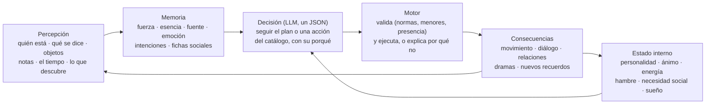
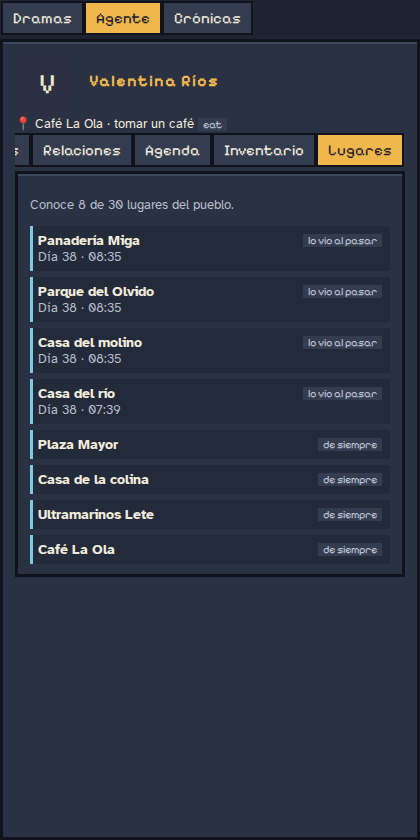
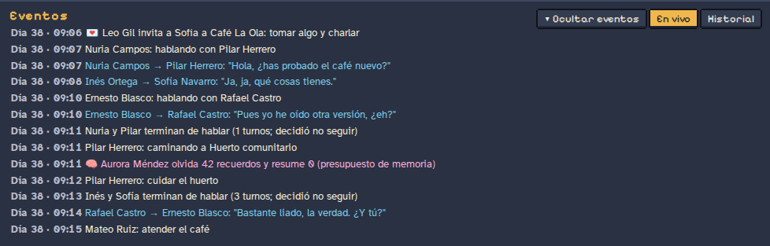
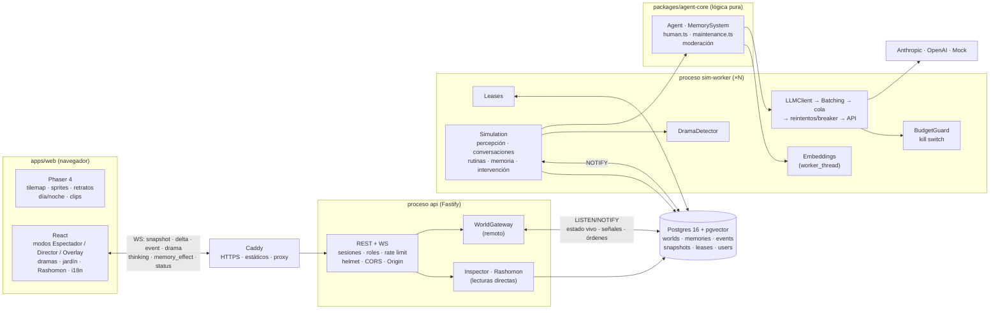
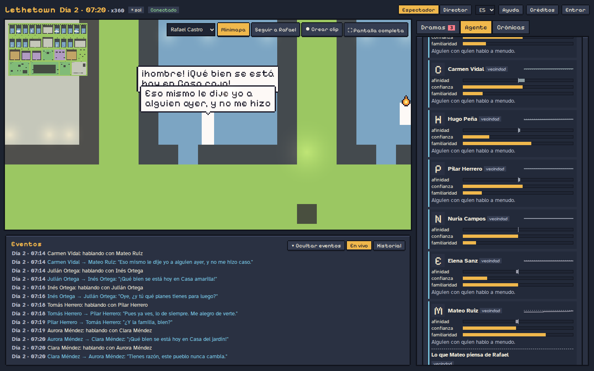
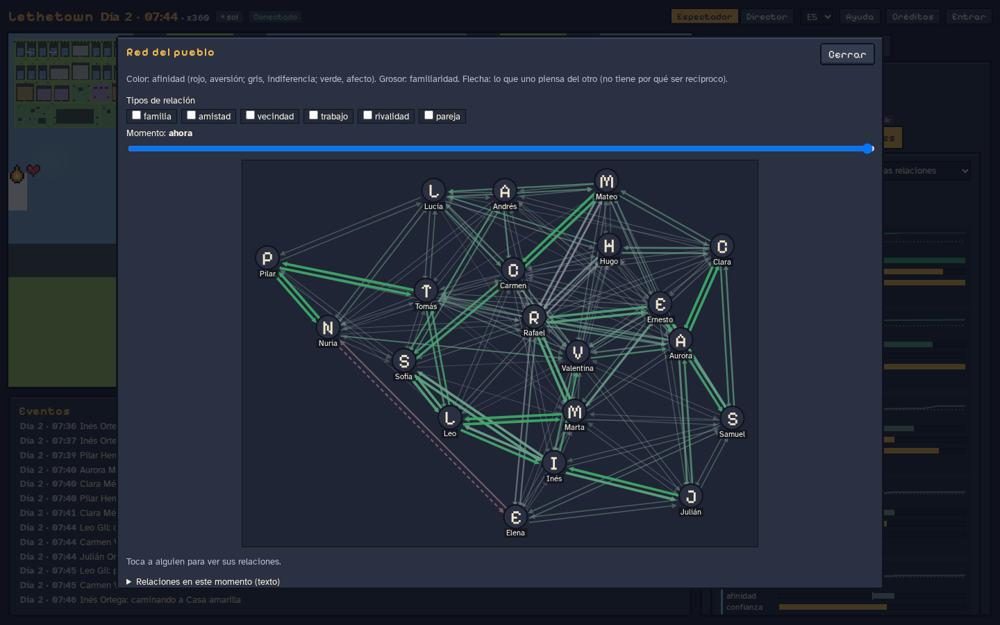
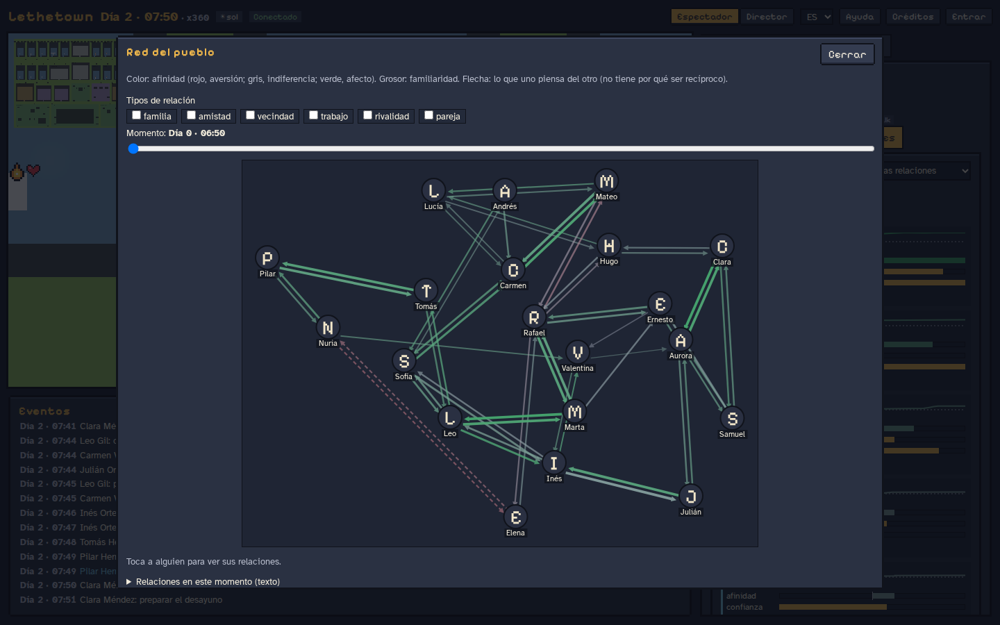
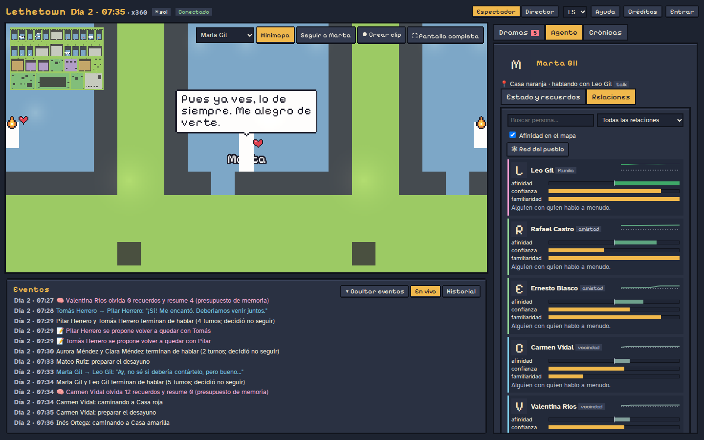
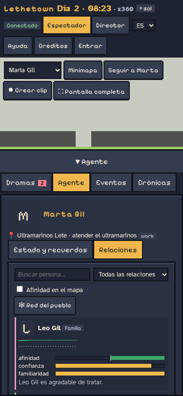

# Arquitectura

Cómo está hecho Lethetown por dentro: un habitante, lo que puede hacer, los procesos y cada
parte de la simulación. El porqué de cada decisión, en [decisiones](decisiones/README.md).

## Un habitante, por dentro

Cada vecino percibe, recuerda, siente, decide y actúa. Hay **dos capas**: reglas programadas
(reloj, rutas, umbrales de memoria, ánimo, necesidades, normas, validación de acciones) y el
modelo de lenguaje, solo donde el lenguaje y el contexto aportan (decidir, conversar, resumir,
reflexionar). Así se controla el coste, se puede auditar cada decisión y las pruebas son
reproducibles.



| Capacidad                   | Qué tiene cada habitante                                                                                                                                                                                                                                                                                                                                                                                                      |
| --------------------------- | ----------------------------------------------------------------------------------------------------------------------------------------------------------------------------------------------------------------------------------------------------------------------------------------------------------------------------------------------------------------------------------------------------------------------------- |
| **Identidad**               | Nombre, edad, rasgos, historia, forma de hablar (registro, muletillas, temas), casa y trabajo. Prompt fijo y cacheable.                                                                                                                                                                                                                                                                                                       |
| **Personalidad**            | Big Five (apertura, responsabilidad, extraversión, amabilidad, neuroticismo) y un perfil de memoria propio: cuánto olvida, cuánto confunde la fuente, lo sugestionable que es, la edad. Cambia muy despacio con lo vivido (unas centésimas por semana como mucho).                                                                                                                                                            |
| **Emociones**               | Ánimo en dos dimensiones, valencia (agradable–desagradable) y activación (calma–tensión), con etiqueta («contento», «irritable», «preocupado»…). Cada uno tiene su nivel base y vuelve a él con el tiempo; el hambre irrita, el cansancio apaga, la soledad entristece. Lo mueven las conversaciones, los plantones, los préstamos sin devolver, los regalos, los intrusos, el tiempo y los recuerdos que vuelven sin querer. |
| **Necesidades**             | Energía, hambre y necesidad social (que depende de la extraversión: un introvertido recarga a solas). Dormir recupera según la calidad del sueño.                                                                                                                                                                                                                                                                             |
| **Memoria**                 | Recuerdos con fuerza que decae, esencia cuando se vuelven vagos, reconsolidación al evocarlos, confusión de fuente, consolidación al dormir, olvido por presupuesto, hábitos, diario del día, recuerdos intrusivos y falsos recuerdos marcados.                                                                                                                                                                               |
| **Intenciones**             | Memoria prospectiva: «tengo que devolverle el libro a Carmen» con pistas de persona, lugar u hora. Se acuerda, se le olvida o cae en la cuenta tarde. Las citas se apoyan en ella.                                                                                                                                                                                                                                            |
| **Relaciones**              | Ficha por persona (afinidad, confianza, familiaridad, tipo de vínculo) con historial, no necesariamente recíproca. Rumores con credibilidad según quién los cuenta, mera exposición, perdón y rencor.                                                                                                                                                                                                                         |
| **Conocimiento del pueblo** | No todos conocen todo: sitios de siempre, vistos al pasar, explorados o que alguien les contó.                                                                                                                                                                                                                                                                                                                                |
| **Pertenencias**            | Inventario con dueño y préstamos (y la intención de devolverlos).                                                                                                                                                                                                                                                                                                                                                             |
| **Habilidades**             | 14 del pueblo (cocina, panadería, café y barra, huerto, pesca, fotografía, música, cuidados…): suben con la práctica (más con un maestro delante), se oxidan sin ella y cambian lo que sale (arreglar, la calidad del café o del pan). Se enseñan unos a otros.                                                                                                                                                               |
| **Saberes**                 | Recetas, técnicas, sitios, historias y canciones del pueblo, cada uno con su versión: se deforman al contarse, se refuerzan con el uso y pueden perderse.                                                                                                                                                                                                                                                                     |
| **Acciones**                | Un catálogo cerrado que el motor valida (siguiente sección).                                                                                                                                                                                                                                                                                                                                                                  |

## Qué pueden hacer los habitantes

**La IA decide, el motor valida y ejecuta.** En cada decisión el modelo elige «seguir con el plan»
o una acción del catálogo con sus parámetros y explica por qué, en la misma llamada. El motor solo
le ofrece las acciones posibles en ese momento; si aun así algo no se puede (un sitio que no
conoce, una casa ajena, un local cerrado, alguien que ya se fue), el agente lo percibe con el
motivo («No pude…»), lo recuerda y puede reconsiderarlo. El estado nuevo se guarda en Postgres
(con `world_id`), en las instantáneas y también funciona en RAM.

| Acción                                                                   | Qué hace                                                            | Qué comprueba el motor                                                             |
| ------------------------------------------------------------------------ | ------------------------------------------------------------------- | ---------------------------------------------------------------------------------- |
| `do_activity`                                                            | Cambiar de actividad o ir a otro sitio                              | Que conozca el sitio, que pueda entrar (casa propia o invitado) y que esté abierto |
| `say`                                                                    | Hablar a alguien; si está conversando, unirse a su grupo            | Que esté aquí y despierto; grupos de hasta 5                                       |
| `propose_meeting`, `accept_meeting`, `decline_meeting`, `cancel_meeting` | Quedar un día a una hora en un sitio                                | Hora razonable, sitio conocido y abierto; con un menor, solo en sitios públicos    |
| `explore`                                                                | Salir a descubrir sitios                                            | Queda algo abierto por descubrir; el motor elige la ruta                           |
| `use_object`                                                             | Preparar café, cocinar, hornear, regar, arreglar algo roto…         | Que el verbo valga en el estado actual del objeto                                  |
| `give_item`, `lend_item`, `return_item`, `take_item`, `leave_item`       | Regalar, prestar, devolver, coger, dejar                            | De quién es, quién lo lleva y quién está delante                                   |
| `invite`, `accept_invite`, `decline_invite`                              | Ir juntos ahora (a tomar algo, a casa)                              | Solo a la casa propia; comparten la ruta                                           |
| `follow`                                                                 | Acompañar a alguien un rato                                         | En cada paso, normas y protección de menores                                       |
| `post_note`, `leave_note`                                                | Colgar una nota en el tablón de la plaza o dejar una nota a alguien | En la plaza / en una casa; nada privado entre adulto y menor                       |
| `practice`                                                               | Ponerse a practicar algo un rato                                    | Que la habilidad exista; el sitio, conocido y abierto; con tiempo libre            |
| `ask_to_learn`, `teach`, `accept_teaching`, `decline_teaching`           | Pedir que te enseñen u ofrecerte a enseñar, y la sesión             | Quien enseña sabe más; con un menor, en público o en su casa con su familia        |
| `help`                                                                   | Ayudar a alguien en lo que está haciendo                            | Que esté haciendo algo que se pueda aprender                                       |
| `show_result`                                                            | Enseñar y regalar algo hecho por uno (una foto, pan)                | Que sea suyo y lo lleve                                                            |
| `share_lore`                                                             | Contar una receta, un sitio, una historia o una canción             | Que lo sepa y no lo haya olvidado                                                  |

Y lo que pasa sin que nadie lo pida: los **plantones** (quien esperaba pierde afinidad y confianza y
se le nota en el ánimo), los **préstamos vencidos** (el dueño lo nota), los **intrusos** (quien
vive en la casa lo ve), los locales que **abren y cierran** (y echan a quien se queda), los
**descubrimientos** al pasar cerca de un sitio y los sitios que se aprenden **porque alguien de
confianza los nombra**. Todo queda en el log con su icono y en el feed de dramas.

<p>
  
  
  
</p>



**Añadir una acción** (detalle en [acciones](decisiones/acciones.md#cómo-añadir-una-acción)):

1. Esquema zod y su `ActionSpec` (parámetros y para qué) en `packages/shared/src/actions/catalog.ts`.
2. Manejador en `apps/server/src/sim/actions/`: `registerAction({ type, available, check, describe, execute })`.
3. Protección de menores (`minorMeetingRule`) y normas (`mayEnter`) si implica a alguien o un lugar.
4. Regla del mock con `registerDecideRule` en `packages/agent-core/src/agent/mock/`.
5. Icono en `apps/web/src/ui/icons.ts` y textos en `i18n`.
6. Tests, dorado regenerado y explicado, y `cost:report 48` antes y después.

## Procesos y paquetes

Ver [producción](decisiones/produccion.md) y [simulación](decisiones/simulacion.md).

En producción (y en `pnpm dev` con Postgres) hay dos procesos: **api** (HTTP + WebSocket, sin
estado de simulación) y uno o más **sim-worker** (ejecutan los mundos). Se reparten los mundos
con _leases_ en Postgres y se hablan por `LISTEN/NOTIFY`. Sin Postgres, el api ejecuta los
mundos en su propio proceso (modo todo en uno).



| Paquete               | Qué contiene                                                                                                                                                                        |
| --------------------- | ----------------------------------------------------------------------------------------------------------------------------------------------------------------------------------- |
| `packages/shared`     | Esquemas zod de los mensajes, parser del mapa Tiled (`.tmj` → `World`), A* determinista, interpolación del movimiento, manifest de assets y lógica pura de animación, emotes y luz. |
| `packages/agent-core` | Lógica pura y testeable, sin red: agente, memoria, memoria humana completa, crónica y entrevistas. El LLM y los almacenes llegan por inyección.                                     |
| `apps/server`         | Procesos `api` y `sim-worker` (o todo en uno): simulación, reloj, base de datos, embeddings, seguridad y **todas** las llamadas a la IA. Las API keys nunca llegan al navegador.    |
| `apps/web`            | Vite + Phaser 4 para el mundo y React para los paneles.                                                                                                                             |

## El mundo

- **`seeds/town.tmj`** es la fuente única de verdad: un mapa [Tiled](https://www.mapeditor.org/) de 120×80 baldosas de 16 px con 20 vecinos, 16 casas, ocho edificios públicos (ayuntamiento, escuela, biblioteca, consultorio, café, panadería, ultramarinos y taberna), la plaza Mayor, el mercadillo, el parque con columpios, el lago Leteo, el Jardín del Recuerdo y el huerto comunitario. Tiene capas `ground`, `paths`, `buildings`, `decor`, `roofs` y `collision`, y objetos `places`, `spots` (con `pose` y dueño), `lights` y `windows`. Lo genera `pnpm map:generate` y se puede editar a mano en Tiled.
- El servidor calcula la ruta A* (que prefiere los caminos) y su duración, y envía los waypoints. El cliente interpola la posición con el reloj de juego y elige el frame según la distancia recorrida, así a x360 se saltan frames en vez de ir a trompicones.
- **Normas**: las casas son privadas (entran quienes viven allí y sus invitados) y los locales tienen horario (`private` y `hours` en el `.tmj`, desde `tools/generate-map.ts`); el tablón de anuncios es un spot de la plaza.
- Los agentes van a **spots** concretos (dormir en su cama, sentarse en la barra) y su `activityKind` decide la animación y el emote.
- **Época y lugar**: `config/world.json` es la biblia del mundo (Mallorca, 2002: tecnología, lo de
  fuera, cultura, glosario, fiestas y clima por estación). Va compacta en el prompt fijo; la fecha
  del calendario y la fiesta del día, en el plan. Cada semilla lleva su **perfil de conocimiento**
  (estudios, oficio, idiomas, viajes, intereses) y la **gente de fuera** que conoce
  (`offstagePeople`: familia lejos, difuntos, amigos de antes). El **registro de conocimiento
  externo** apunta anacronismos y referencias que no encajan con quien habla, sin bloquear nada
  (modo `log`). Ver
  [mundo](decisiones/mundo.md#mallorca-2002-la-biblia-del-mundo-y-lo-que-sabe-cada-uno).

### Por qué 2002 (y no 1996)

En un principio el pueblo vivía en **1996**: se eligió para que hubiera poca tecnología (nada de
internet en casa ni móviles corrientes), y así las conversaciones fueran en persona, por carta o
por el fijo, y los agentes no se apoyaran en lo que no existía. Lo que no se tuvo en cuenta fue
la **moneda**: en 1996 se pagaba en pesetas, y la siguiente fase es la **economía**. Con pesetas
los precios son números grandes (un café, cien pesetas; un sueldo, más de cien mil) que el modelo
y quien estudia las partidas tienen que convertir para compararlos con nada actual.

Por eso se ha pasado a **abril de 2002**: el euro está en circulación desde el 1 de enero y es
una moneda ya establecida (los precios son pequeños y comparables: un café, unos 90 céntimos;
un menú, unos 7 euros), lo que hace la economía más fácil de calibrar y la investigación más
sencilla (se leen los precios sin convertir, y entre partidas se comparan igual). Y casi todo lo
que se buscaba con 1996 sigue ahí: el móvil es sencillo (llamadas y SMS), internet es lento, caro
y de pocas casas, las fotos son de carrete y no hay redes sociales, mensajería instantánea en el
teléfono ni nada de lo posterior. Como recién llegado el euro, más de uno aún lo pasa a pesetas en
la cabeza («eso son mil pesetas»), que es natural en la época.

Lo que cambió: la biblia (año, moneda, tecnología, lo de fuera, personajes y referencias de la
época, anacronismos: el euro, el móvil, los SMS, internet o el DVD ya no lo son; IB3, Son Espases,
los smartphones o las redes sociales, sí), un par de semillas (la libreta del fiado de Marta en
euros; la música de Inés y los dibujos de Leo, de su edad en 2002) y los tests. El 15 de abril de
2002 también cae en lunes, así que el calendario de partida es el mismo.

- **Habilidades y saberes** (fase 3): 14 habilidades que suben con la práctica y se oxidan sin
  ella, y 24 saberes del pueblo que cada uno sabe a su manera. Ver [habilidades](decisiones/skills.md)
  y [saberes](decisiones/lore.md).
- **Nadie inventa vecinos** («la Pepa» de la segunda partida de estudio): el `PersonGuard` cambia
  por «alguien» el nombre de una persona que no existe (en la decisión, antes repite una vez con
  el aviso; una intención así se descarta) y lo registra. Ver [personas](decisiones/personas.md).

## Memoria

Cada recuerdo lleva: texto, esencia (`gist`), embedding, `createdAt` y `lastAccessedAt` (en tiempo de juego), `importance` (1-10), `emotionalValence` (-1..1), `strength`, `stability`, `source`, `type`, personas, lugar, `eventId` (para Rashomon), `links` (citas o episodios resumidos), `status` (`active` o `archived`) y `forgottenAt`.

```
total = media_ponderada(recencia, importancia, relevancia, coincidencia_de_ánimo) × fuerza_actual
fuerza = strength · e^(−horas / stability)        olvidado < 0.05 ≤ vago < 0.3 ≤ nítido
```

Todos los parámetros (pesos, umbrales, probabilidades, presupuesto) están en `packages/agent-core/src/memory/config.ts`, con valores por defecto documentados. Se pueden sobrescribir con un `config/memory.json` opcional.

| Mecanismo              | Cuándo                               | Qué hace                                                                                                                                                           |
| ---------------------- | ------------------------------------ | ------------------------------------------------------------------------------------------------------------------------------------------------------------------ |
| Consolidación          | Al dormirse                          | Preguntas salientes, reflexiones con citas, hechos estables y fichas sociales; refuerza lo citado y debilita lo trivial.                                           |
| Esencia                | Mantenimiento horario                | Al cruzar el umbral de vaguedad, el LLM resume el recuerdo; el texto completo solo lo ve el inspector.                                                             |
| Reconsolidación        | Al recordar (10 %)                   | Reescritura sutil según el ánimo y las fichas sociales; guarda la versión anterior.                                                                                |
| Confusión de fuente    | Mantenimiento (5 % al día)           | "contado por X" pasa a "vivido" o a otra persona.                                                                                                                  |
| Olvido por presupuesto | Si se superan 4000 tokens por agente | 1) borra triviales viejos, 2) resume grupos de episodios en una reflexión enlazada, 3) descarta lo de menor importancia × fuerza. Nunca toca los planes recientes. |
| Rumores                | Al hablar                            | Quien esté cerca capta fragmentos, con fuente difusa.                                                                                                              |
| Fin de conversación    | Al recibir una frase                 | Cada agente decide si sigue; pasados 12 turnos, solo si aporta (máximo 30), y se corta si se repiten. Al terminar, fichas sociales y acuerdos hablados.            |

Ver [memoria](decisiones/memoria.md).

## Tiempo, voz interior y cambios de planes

- **Tiempo**: sol, nubes, lluvia, tormenta, nieve, niebla, viento y calor (`Weather`). Cada uno dice qué refugio
  pide (`WEATHER_SHELTER`): techo de verdad (tormenta, nieve), techo o algo que cubra (lluvia) o sombra (calor).
  Los lugares exteriores van marcados en el prompt y los objetos a cubierto (árboles, toldos del mercadillo,
  invernadero) llevan `[refugio]`. En cada decisión el agente sabe si está bajo techo, a cubierto o
  mojándose; al planificar sabe el tiempo de la mañana; y si con mal tiempo lo que toca en su plan es al aire
  libre, se le avisa (una vez por hora) para que decida si va, se queda o cambia de sitio.
- **Voz interior**: llega en una sección propia del prompt (`VOZ INTERIOR`) y el agente responde siempre con
  un `reason` (por qué le hace caso o no). El inspector muestra «Lo que piensa» y el log, «le hace caso / no le
  hace caso — «…»».
- **Cambios de planes**: cada reacción reescribe el plan del día desde ese minuto (`replanAt`), así que el
  inspector muestra lo que el agente hace de verdad (marcado como «cambio de planes»).
- **Diario del día**: cada actividad que empieza se anota en `doneToday` (memoria a corto plazo, sin LLM ni
  recuerdo por actividad; con poca energía se pierden o mezclan entradas). Al decidir ve «HOY YA HAS HECHO». Al
  dormirse, el día se guarda como un único recuerdo («El día N: …») y las rutinas repetidas se vuelven hábitos;
  al planificar recuerda ayer y sus costumbres desde la memoria (con olvido y vaguedad).

## Conversaciones con ritmo

- **Turnos reactivos**: quien recibe una frase contesta al minuto de juego (`SIM_REPLY_DELAY_MINUTES`), no a su siguiente tick de 10 minutos.
- **Habla oral**: réplicas cortas, a veces de una a tres palabras, sin saludar en cada turno ni repetir lo dicho. Cada agente ve las 4 últimas frases de la charla (las suyas como «tú: …»). Lo que dice se recorta en código según su forma de hablar (90/160/240 caracteres; los menores, 120).
- **Menos espera**: en una charla en curso, la importancia de lo que se oye sale de reglas y no de otra llamada; la reconsolidación de lo recordado se hace después de contestar; la cola del LLM atiende antes conversación y decisiones que esencias, fichas, resúmenes y crónicas.
- **A más de x10**, mientras hay conversaciones el reloj va a x10 (`SIM_SLOWDOWN_IN_CONVERSATION`) para que se puedan seguir.
- **Noche rápida** (`SIM_NIGHT_SPEED`, desactivada por defecto): con todo el pueblo dormido y nada pendiente del LLM, la noche pasa a ese ritmo y vuelve a `SIM_SPEED` antes de despertar (`SIM_WAKE_MARGIN_MINUTES`).

Detalle y mediciones en [ritmo](decisiones/ritmo.md).

## Cognición en movimiento

Quien camina ya no va a ciegas. Cada 2 minutos de juego, sin LLM, el motor mira quién se cruza
con quién (también a quien ve venir por su ruta). Lo que le importa ese encuentro lo calcula el
código (afinidad, familia, rivalidad, algo pendiente como el libro de Carmen, una deuda o una
cita, el ánimo que se le ve, días sin verse); solo si importa de verdad se para a pensar, sin
dejar de andar: seguir, saludar al pasar, pararse a charlar o cambiar de destino. Quien se para
retoma luego su camino (y su plan). Los que van juntos hablan andando, nadie deja de cocinar o
de atender el café por hablar, y pasar por un sitio o ver a alguien trae recuerdos («le viene a
la cabeza…»), sin LLM. Se apaga por mundo (`worlds.cognition`, `SIM_COGNITION=off`) para un mundo
de control. Ver [cognición](decisiones/cognicion.md).

## Agentes y coste

- **Sin llamadas extra por acción**: todas van en la misma decisión. Cómo se usa cada acción va en el prompt fijo (cacheado); en cada decisión solo «Posibles ahora: …».

- La **identidad** del agente (rasgos, lugares, objetos y reglas) es un prefijo fijo del prompt, para el _prompt caching_.
- **Rutinas sin LLM**: dormir, desplazarse y seguir el plan cuando no pasa nada nuevo.
- Modelo `fast` para decidir, valorar importancia, esencia, reconsolidación, fichas y resúmenes; modelo `reflection` para el plan, la consolidación y la crónica. Qué modelo usa cada tarea (y la duración de su caché) se cambia en `config/llm-routing.json`.
- El `CostTracker` registra tokens y coste por agente, tarea y modelo. Los precios están en `config/pricing.json`.

Ver [LLM, mock y coste](decisiones/llm.md).

## Sistemas

Citas, inventario, objetos, invitar y acompañar, notas, normas, lugares conocidos y el puente de
los acuerdos hablados son **sistemas** (`SimSystem`, en `apps/server/src/sim/systems/`): cada uno
declara sus acciones, su parte de la instantánea (con su versión), su revisión periódica, sus
secciones del prompt, su retención y sus métricas, y `simulation.ts` solo recorre el registro.
Se pueden desactivar por mundo (`worlds.systems`, `{ "notes": false }`). El mundo de 2002
(`world`), lo que sabe cada uno (`knowledge`) y las **metas** (`goals`: vital, proyectos y pasos
medibles, motivación y frustración, conflictos, marcharse del pueblo; ver
[metas](decisiones/metas.md)) ya son sistemas. Los siguientes (economía, oficios,
construcción, ciclo vital) entran igual: ver
[Cómo añadir un sistema](decisiones/sistemas.md#cómo-añadir-un-sistema).

**Lo acordado hablando llega al motor**: la tarea `social` de fin de charla devuelve también los
acuerdos («quedamos mañana a las cinco en el café», «te dejo el libro»), y cada uno pasa por el
mismo manejador que la acción formal (normas, menores…). En el log llevan 🗣. Ver
[acciones](decisiones/acciones.md#puente-de-la-conversación-a-la-acción).

## Psicología

Toda la lógica es pura (agent-core, con tests), sin LLM salvo donde se dice, y todos los parámetros están en
`MemoryConfig` (`packages/agent-core/src/memory/config.ts` y los esquemas que importa), sobrescribibles con
`config/memory.json`. Detalle y decisiones: [psicología](decisiones/psicologia.md).

| Fenómeno              | Qué hace                                                                                                                                                                                                                                                        | Parámetros                                                     |
| --------------------- | --------------------------------------------------------------------------------------------------------------------------------------------------------------------------------------------------------------------------------------------------------------- | -------------------------------------------------------------- |
| Protección de menores | Regla fija en el prompt de todos con la lista de menores; `MinorGuard` revisa lo que escribe el LLM (léxico claro → descarte; ambiguo → moderación `fast`, fail-closed). Lo descartado va a `moderation_log`. Las relaciones con un menor nunca son románticas. | — (`isMinor` en la semilla)                                    |
| Hábitos               | Las actividades no crean recuerdos; lo repetido en 3 de 7 días se vuelve «Suelo … por las mañanas» y se refuerza. Sin esencia del LLM para importancia ≤ 2.                                                                                                     | `diary`, `habits`, `gist.minImportance`                        |
| Perfil de memoria     | Big Five + `memoryProfile` de la semilla + edad: los mayores olvidan antes lo vivido y conservan y evocan sus recuerdos de juventud (pico de reminiscencia); los niños confunden más la fuente y son más sugestionables.                                        | `profile`                                                      |
| Ánimo                 | Valencia y activación con etiqueta circumpleja; nivel base por personalidad y vuelta con vida media; hambre → irritable, cansancio → apagado, soledad → triste. Necesidades según extraversión.                                                                 | `mood`, `needs`                                                |
| Codificación y sueño  | Fuerza inicial por Yerkes-Dodson, energía, atención y deuda de sueño; con activación extrema solo queda la esencia. Dormir con tensión o preocupación recupera menos; el sueño consolida lo emocional.                                                          | `encoding`, `sleep`                                            |
| Sesgos                | Negatividad (lo malo dura más), desvanecimiento afectivo (lo malo se suaviza antes), recuerdos intrusivos (vuelven sin buscarlos, con pistas), falsos recuerdos (rellenar huecos, tarea `confabulate`, marcados).                                               | `profile.negativityBias`, `biases`, `intrusive`, `falseMemory` |
| Memoria prospectiva   | Intenciones con pistas (persona, lugar, hora); al aparecer la pista se acuerda o no según responsabilidad y perfil; si no, «¡vaya, se me olvidó!». Se detectan en charlas y decisiones.                                                                         | `prospective`                                                  |
| Relaciones            | Afinidad, confianza, familiaridad y tipo (familia, amistad, vecindad, trabajo, rivalidad, pareja) con historial; credibilidad de los rumores, mera exposición, perdón y rencor. Estilo de habla propio por agente.                                              | `social`                                                       |

En la web: pestaña «Relaciones» del inspector (con la relación recíproca y su evolución), «Red del pueblo»
(grafo con deslizador de tiempo) y afinidad sobre el mapa.







