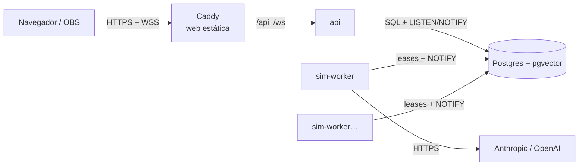

# Despliegue en un VPS

Producción = `docker-compose.prod.yml`: **Caddy** (HTTPS automático con Let's Encrypt, web
estática y proxy de `/api` y `/ws`), **api** (Fastify, sin estado de simulación), uno o más
**sim-worker** (ejecutan los mundos) y **Postgres 16 + pgvector**. Solo Caddy publica puertos
(80/443); Postgres y la API quedan en la red interna de Docker.



## Requisitos

- Un VPS con Docker y el plugin compose (2 vCPU y 4 GB de RAM van sobrados para unos pocos
  mundos; los embeddings locales usan ~300 MB por proceso).
- Un dominio con un registro A/AAAA apuntando al VPS (Caddy necesita los puertos 80 y 443
  abiertos para emitir el certificado).

## 1. Código y variables

```bash
git clone https://github.com/jaume768/Lethetown.git && cd Lethetown
cp .env.example .env
```

En `.env`, como mínimo:

```dotenv
NODE_ENV=production
DOMAIN=lethetown.example.com
ACME_EMAIL=tu@correo.com
POSTGRES_PASSWORD=<openssl rand -base64 24>
LLM_PROVIDER=anthropic
ANTHROPIC_API_KEY=sk-ant-...
NO_VIEWERS_MODE=pause
# Opcional
SENTRY_DSN=
METRICS_TOKEN=<openssl rand -hex 24>
```

`DATABASE_URL`, `HOST`, `TRUST_PROXY` y `ALLOWED_ORIGINS` los fija el compose a partir de
`DOMAIN` y `POSTGRES_*`. `chmod 600 .env`.

## 2. Assets de LimeZu (no van en las imágenes)

La licencia prohíbe redistribuirlos, así que no están en el repo ni en las imágenes: se suben
al servidor aparte y Caddy los monta en `/srv/assets/vendor`.

```bash
# Desde tu máquina:
rsync -av apps/web/public/assets/vendor/ vps:Lethetown/apps/web/public/assets/vendor/
```

Antes, `pnpm assets:check` te dice qué assets en uso no son comerciales (Modern Interiors
Free): **no los uses en un despliegue comercial**. Sin la carpeta, el juego arranca con el
pack `placeholder` (hay que regenerar el mapa con `pnpm map:generate --pack placeholder`).

## 3. Arrancar

```bash
docker compose -f docker-compose.prod.yml up -d --build
docker compose -f docker-compose.prod.yml logs -f api worker
```

El servicio `migrate` aplica las migraciones antes de que arranquen `api` y `worker`.

Crear el primer administrador (la contraseña se pide sin eco):

```bash
docker compose -f docker-compose.prod.yml run --rm -it api \
  node --import tsx src/scripts/user-create.ts admin admin
```

Roles: `viewer` (solo mira; también sin cuenta), `director` (velocidad, voz interior, objetos,
clima, crónicas) y `admin` (además costes, health detallado, kill switch y mundos).

## 4. Escalar

Cada `sim-worker` ejecuta hasta `WORKER_MAX_WORLDS` mundos y los reparte con los demás mediante
leases en Postgres (si un worker muere, otro recoge sus mundos al caducar la lease,
`WORKER_LEASE_SECONDS`, desde la última instantánea):

```bash
docker compose -f docker-compose.prod.yml up -d --scale worker=3
```

## 5. Operación

- **Kill switch** (para todas las llamadas al LLM y pausa todos los mundos):
  `curl -X POST https://$DOMAIN/api/admin/kill -H 'content-type: application/json' -H "origin: https://$DOMAIN" -b cookie.txt -d '{"on":true}'`
  (o desde el modo Director con una cuenta admin).
- **Gasto**: `GET /api/admin/budget` (gasto de hoy y del mes, por mundo, y kill switch). No hay
  límites de gasto en el servidor: se controlan con el saldo de la API key del proveedor.
- **Métricas**: Prometheus en la red interna contra `http://api:3001/metrics` con
  `Authorization: Bearer $METRICS_TOKEN` (Caddy no expone `/metrics`). Coste por hora:
  `rate(lethetown_llm_cost_usd_total[1h]) * 3600`; cache hit:
  `rate(lethetown_llm_tokens_total{kind="cache_read"}[1h]) / ignoring(kind) sum without(kind) (rate(lethetown_llm_tokens_total{kind=~"input|cache_read|cache_write"}[1h]))`;
  ticks/s: `rate(lethetown_sim_agent_ticks_total[5m])`.
- **Logs**: JSON por stdout (pino); `LOG_LEVEL=debug` incluye cada evento de la simulación.
- **Copias de seguridad**:
  `docker compose -f docker-compose.prod.yml exec db pg_dump -U lethetown lethetown | gzip > lethetown-$(date +%F).sql.gz`
- **Actualizar**: `git pull && docker compose -f docker-compose.prod.yml up -d --build`. Al
  parar, los workers guardan una instantánea y sueltan sus leases (`stop_grace_period: 30s`).

## Notas de seguridad

- Postgres no publica puertos; en desarrollo, `docker-compose.yml` lo liga a `127.0.0.1`.
- Las cookies de sesión son `httpOnly`, `Secure` y `SameSite=Lax`; las peticiones que mutan
  exigen un `Origin` permitido (CSRF) y el WebSocket también comprueba el Origin.
- La imagen del servidor corre como usuario `node`, sin `.env` ni assets dentro (`.dockerignore`).
- Las imágenes ocupan ~1,3 GB (servidor, por onnxruntime y transformers.js) y ~60 MB (web).
